<p align="center"><b>NATIONAL INSTITUTE OF TECHNOLOGY KARNATAKA, SURATHKAL</b></p>

<p align="center"></p>

<h1 align="center">Reduced-Parameter Water Quality Index Prediction for Data-Scarce River Systems</h1>

<p align="center"><i>Evidence from the CPCB National Water Quality Monitoring Programme, 2018–2021</i><br>
Final Project Report</p>

<p align="center"><b>Course:</b> CV301: Environmental Engineering &nbsp;·&nbsp; <b>Faculty:</b> Saranya P</p>

<div align="center">

| Team member | Roll number |
|---|---|
| Mayank Tiwari | 241CV235 |
| Krupa Marol | 241CV231 |
| Srushti Dongre | 241CV248 |
| Sreenidhi Golamaru | 241CV247 |
| Bharath Chowdary | 241CV213 |

October 2026

</div>

---

## Abstract

**Question.** Can reduced-parameter monitoring provide reliable Water Quality Index (WQI) prediction for data-scarce river systems?

**Data.** 32,968 river monitoring visits (888 stations, 87 rivers, 2018–2021) from the CPCB National Water Quality Monitoring Programme were cleaned, joined and audited. Only 14.7% of visits report all eight parameters needed for the CPCB weighted-arithmetic WQI, and all of them fall in a single year (2020). By contrast, 75.8% report pH, dissolved oxygen (DO) and BOD.

**Methods.** The capped full-panel WQI of 4,861 fully observed visits (593 stations) is the fixed target. Eight model families, from the no-ML renormalised formula to XGBoost and Gaussian processes, are trained on twelve named parameter subsets and on all 255 possible subsets. They are evaluated on held-out stations, rivers, states and seasons. Further experiments cover parameter importance (eight methods), data scarcity (2–100% of training stations), conformal and Gaussian-process prediction intervals, missing data, measurement noise, and sensitivity to the index definition. The model is then deployed on 20,132 visits that lack a full panel.

**Results.** An exact variance decomposition shows that the CPCB unit weights ($`\propto 1/S_i`$) concentrate 87.5% of index variance in pH and BOD, while fecal coliform, total coliform and EC together explain under 0.3%. All model-based importance methods agree. At unseen stations, XGBoost on pH, DO and BOD reaches R² = 0.957, RMSE 2.9 points and 90.6% category accuracy, against R² = 0.863 for re-computing the index from the same three parameters. pH, BOD and turbidity reach 0.977, and adding DO gives 0.994. No reduced-parameter prediction is ever off by more than one category. Accuracy holds for unseen rivers and states (R² ≥ 0.94). Learned models need data from about 25 or more stations to beat the formula, and GPR is best when data are scarcest. Split-conformal intervals keep nominal coverage (90% intervals of about ±4.7 points for the three-parameter model). Field-level pH noise ($`\sigma=0.1`$) costs more accuracy than dropping five parameters. Conclusions are specific to the index definition: under equal weights the same three parameters explain only 62% of the variance. Deployment yields the first full-panel WQI estimates for 255 stations. It also reveals a BOD reporting floor outside 2020 that confounds year-to-year comparisons.

**Conclusion.** For the CPCB index, a precisely measured three-parameter panel (pH, DO, BOD), plus a turbidity probe where possible, gives reliable WQI estimates with calibrated uncertainty at unmonitored-panel sites. Fecal coliform exceedance should be reported alongside it, because the CPCB weighting ignores it.

## Contents

- [Abstract](#abstract)
- [1. Introduction](#1-introduction)
  - [1.1 Motivation](#11-motivation)
  - [1.2 Research question](#12-research-question)
  - [1.3 Approach in one paragraph](#13-approach-in-one-paragraph)
  - [1.4 Contributions](#14-contributions)
  - [1.5 Organisation](#15-organisation)
- [2. Background](#2-background)
  - [2.1 Water quality indices](#21-water-quality-indices)
  - [2.2 Machine learning for WQI estimation](#22-machine-learning-for-wqi-estimation)
  - [2.3 Interpretability and evaluation](#23-interpretability-and-evaluation)
- [3. Data](#3-data)
  - [3.1 Source](#31-source)
  - [3.2 Cleaning and integration pipeline](#32-cleaning-and-integration-pipeline)
  - [3.3 Parameter availability: the full panel exists for one year only](#33-parameter-availability-the-full-panel-exists-for-one-year-only)
  - [3.4 The labelled set](#34-the-labelled-set)
- [4. Ground-Truth Water Quality Index](#4-ground-truth-water-quality-index)
  - [4.1 Formula](#41-formula)
  - [4.2 Why the sub-indices are capped](#42-why-the-sub-indices-are-capped)
  - [4.3 What actually drives the index](#43-what-actually-drives-the-index)
- [5. Methodology](#5-methodology)
  - [5.1 Problem formulation](#51-problem-formulation)
  - [5.2 Parameter subsets](#52-parameter-subsets)
  - [5.3 Models](#53-models)
  - [5.4 Validation schemes](#54-validation-schemes)
  - [5.5 Metrics](#55-metrics)
  - [5.6 Further experiments](#56-further-experiments)
  - [5.7 Reproducibility](#57-reproducibility)
- [6. Results](#6-results)
  - [6.1 Which parameters matter? (RQ1)](#61-which-parameters-matter-rq1)
  - [6.2 How few parameters are enough? (RQ2)](#62-how-few-parameters-are-enough-rq2)
  - [6.3 Model comparison](#63-model-comparison)
  - [6.4 Generalisation beyond the training stations](#64-generalisation-beyond-the-training-stations)
  - [6.5 How little data is enough? (RQ3)](#65-how-little-data-is-enough-rq3)
  - [6.6 Can the model say when not to trust it? (RQ4)](#66-can-the-model-say-when-not-to-trust-it-rq4)
  - [6.7 Robustness to missing readings and measurement noise](#67-robustness-to-missing-readings-and-measurement-noise)
  - [6.8 Sensitivity to the definition of the index](#68-sensitivity-to-the-definition-of-the-index)
  - [6.9 Deployment: reconstructing WQI where it was never computed](#69-deployment-reconstructing-wqi-where-it-was-never-computed)
- [7. Discussion](#7-discussion)
  - [7.1 Answer to the research question](#71-answer-to-the-research-question)
  - [7.2 Recommended monitoring kit](#72-recommended-monitoring-kit)
  - [7.3 Why learning beats re-weighting the formula](#73-why-learning-beats-re-weighting-the-formula)
  - [7.4 The coliform blind spot](#74-the-coliform-blind-spot)
  - [7.5 Comparison with the original project plan](#75-comparison-with-the-original-project-plan)
  - [7.6 Limitations and threats to validity](#76-limitations-and-threats-to-validity)
- [8. Conclusion and Future Work](#8-conclusion-and-future-work)
- [References](#references)
- [Appendix A. Model hyper-parameters](#appendix-a-model-hyper-parameters)
- [Appendix B. Full result tables](#appendix-b-full-result-tables)
- [Appendix C. Reproducing the results](#appendix-c-reproducing-the-results)

## 1. Introduction

### 1.1 Motivation

A Water Quality Index (WQI) condenses a panel of physical, chemical and biological measurements into one number and one category, so that a river reach can be called “good” or “poor” by people who will never read a laboratory sheet. It is the standard way Indian and international agencies communicate river condition to the public and to decision-makers \[9, 4, 17, 18\]. The difficulty is that a WQI is only as available as its *full* parameter panel. Several of the panel’s inputs are slow or expensive: biochemical oxygen demand (BOD) needs a five-day incubation, coliform counts need 24–48 h of culturing, and nutrients need laboratory chemistry. A station that misses any one of them on a given visit cannot report a WQI for that visit.

This is not a hypothetical problem. In the Central Pollution Control Board (CPCB) National Water Quality Monitoring Programme (NWMP) river data analysed here, only **14.7%** of the 32,968 river monitoring visits between 2018 and 2021 report all eight parameters needed for the index. In contrast, **75.8%** report pH, dissolved oxygen (DO) and BOD (Section 3). Most of the monitoring that actually happens is therefore already “reduced-parameter” monitoring, whether by design or by gap. If those reduced panels can be converted into a reliable estimate of the full-panel WQI, then the index becomes available for roughly five times as many visits. It also becomes available for stations and years that never had a full panel at all.

### 1.2 Research question

> **Research question**
>
> *Can reduced-parameter monitoring provide reliable WQI prediction for data-scarce river systems?*

We make “reliable” operational through four sub-questions, each answered by a dedicated experiment:

1.  **Which parameters matter?** Which of the eight available parameters carry the information in the index? Does the answer depend on the method used to measure importance?

2.  **How few are enough?** How much accuracy is lost going from 8 to 7, 5, 4 and 3 parameters, and does *which* parameters are kept matter more than *how many*?

3.  **How little data is enough?** How does accuracy decay when the model is trained on only a few stations, and when it is applied to stations, rivers, states and seasons it has never seen?

4.  **Can the model say when not to trust it?** Do its prediction intervals hold their nominal coverage on unseen stations? How robust is it to missing readings and to field measurement noise?

### 1.3 Approach in one paragraph

We treat the problem as *surrogate modelling* (Figure 1). The ground-truth index $`y=g(x_1,\dots,x_8)`$ is computed once, with the CPCB weighted-arithmetic formula, from the 4,861 river visits that have all eight parameters. A machine-learning model $`f_S`$ is then trained to predict that *same* $`y`$ from a subset $`S`$ of the inputs. The target never changes; only the inputs the model may see do. This is what makes comparisons across subset sizes fair. We compare eight model families on twelve named subsets and on all 255 possible subsets. We use validation schemes that hold out whole stations, rivers, states or seasons, and add data-scarcity sweeps, calibrated prediction intervals, robustness tests and sensitivity analyses on the definition of the index itself. Finally, we apply the chosen reduced-parameter model to the roughly 20,000 real visits that lack a full panel.

<p align="center">
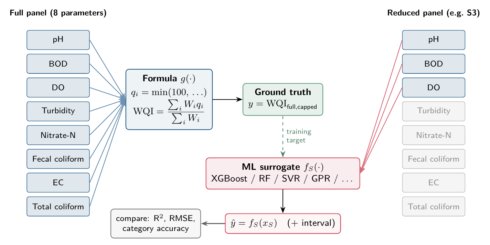
</p>

> **Figure 1.** The surrogate-modelling framing used throughout. The ground truth is the CPCB weighted-arithmetic WQI computed from all eight parameters (left). A model sees only a subset of the inputs (right; S3 = pH, BOD, DO shown) and is trained to reproduce the same full-panel target.

### 1.4 Contributions

1.  A cleaned, audited, river-only CPCB dataset with a documented ground-truth WQI. We find that the full eight-parameter panel exists for *only one year* (2020) of the 2018–2021 record (Section 3).

2.  An exact variance decomposition of the CPCB index. It shows that the $`1/S_i`$ unit weights make fecal coliform, total coliform and electrical conductivity almost weightless: together they explain under 0.3% of index variance (Section 4).

3.  A consensus importance ranking from eight methods and an exhaustive search over all 255 subsets, under station-held-out validation (Sections 6.1 and 6.2).

4.  A model comparison across five validation schemes. It shows that a three-parameter model predicts the full-panel index with R² ≈ 0.95–0.98 at stations it has never seen, and that it clearly beats the obvious no-ML alternative of re-weighting the formula over the available parameters (Section 6.3).

5.  Data-scarcity curves, calibrated conformal prediction intervals, and missing-data and sensor-noise robustness tests (Sections 6.5, 6.6 and 6.7).

6.  Sensitivity of every conclusion to the definition of the index (standard values, equal weights, uncapped scale) (Section 6.8).

7.  A deployment that reconstructs full-panel WQI for about 20,000 visits that never had one, with a covariate-shift audit (Section 6.9). It ends in a concrete recommended monitoring kit (Section 7).

### 1.5 Organisation

Section 2 reviews WQI formulations and machine-learning approaches. Section 3 describes the data and the cleaning pipeline. Section 4 defines the ground truth and analyses what drives it. Section 5 gives the experimental methodology and Section 6 the results. Section 7 answers the research question, gives the recommended kit and discusses limitations, and Section 8 concludes. The appendices list hyper-parameters, full result tables and reproduction commands.

## 2. Background

### 2.1 Water quality indices

Horton \[9\] proposed the first general water quality index. It was a weighted combination of rating scores for individual parameters. Brown et al. \[4\] developed it into the National Sanitation Foundation (NSF) WQI, with weights elicited from a panel of experts and curve-based sub-indices. Two families now dominate practice \[18\]:

- **Weighted-arithmetic indices**, widely used in Indian river studies \[17\]. Each parameter $`i`$ is converted to a quality rating $`q_i`$ relative to a permissible standard $`S_i`$ and an ideal value. It receives a unit weight $`W_i \propto 1/S_i`$, and the index is the weighted mean $`\sum W_i q_i / \sum W_i`$. The method is transparent and easy to compute. However, its weights depend on the *units* in which the standards happen to be expressed, a property whose consequences we quantify in Section 4.3.

- **Exceedance-based indices**, most prominently the CCME WQI \[5\]. These combine the scope, frequency and amplitude of standard violations over a period, rather than scoring each sample.

In both families the index is a deterministic function of its inputs. Predicting the index from *all* of its inputs is therefore trivial. The scientifically interesting question is how much of it can be recovered from a *subset* of them, and how that depends on which inputs are dropped.

### 2.2 Machine learning for WQI estimation

A large applied literature uses supervised learning to estimate WQI or WQI classes from water-quality parameters. Typical models are tree ensembles such as random forests \[3\] and gradient boosting \[6\], support vector machines, *k*-nearest neighbours and neural networks. Several studies have estimated an index from a reduced set of parameters \[e.g. 1\]. Three methodological weaknesses recur in this literature, and this study is designed to avoid them:

1.  **Random row splits.** Visits from the same station are strongly correlated, so a random train/test split lets a model “recognise” a station it has already seen. This overstates accuracy for new sites. Structured, grouped cross-validation is recommended for exactly this situation \[15\].

2.  **Moving targets.** Some studies compute a reduced-parameter WQI for each subset and then predict *that*. Because the target then changes with the subset, accuracies are not comparable across subset sizes. We keep the full-panel target fixed.

3.  **No uncertainty.** Point predictions without calibrated intervals cannot tell an operator when a reduced-panel estimate should not be trusted. We use Gaussian processes \[14\] and distribution-free conformal prediction \[19, 16, 2\].

### 2.3 Interpretability and evaluation

We rank parameter importance with impurity and gain importances, permutation importance, mutual information \[10\] and SHAP values \[11\], plus an exact analytic decomposition of the formula. For evaluation we report R² (which on held-out data equals the Nash–Sutcliffe efficiency, NSE \[12\]), RMSE, MAE, the Kling–Gupta efficiency (KGE \[8\]) and the accuracy of the resulting WQI category. The category is arguably the quantity a decision-maker actually uses.

## 3. Data

### 3.1 Source

All data come from the CPCB *Surface Water Quality (Manual)* datasets published on the National Water Data Portal (`nwdp.nwic.gov.in`). The portal splits the NWMP record into three thematic tables, each further split by state/UT and time bucket:

**Table 1.** Raw downloads. The “1961–2020” file bucket is a portal label only: every record actually falls between 2018-01-01 and 2024-07-01.

| Table      | Files |    Rows |  Size | Parameters used here                |
|:-----------|------:|--------:|------:|:------------------------------------|
| Physical   |    70 |  94,159 | 15 MB | EC, Turbidity                       |
| Chemical   |    71 | 109,683 | 27 MB | pH, DO, Nitrate-N                   |
| Biological |    70 | 107,537 | 16 MB | BOD, Fecal coliform, Total coliform |
| Total      |   211 |       – | 57 MB | 8 parameters                        |

### 3.2 Cleaning and integration pipeline

The pipeline (`scripts/build_dataset.py`, summarised in Figure 2) performs the following steps.

1.  **Parse and de-duplicate.** Acquisition timestamps are parsed to dates. Same-station, same-day repeat readings within a file are averaged.

2.  **Join.** The three tables are *not* row-aligned after 2020: physical parameters are logged far less often than chemical and biological ones. They are therefore outer-joined on (station, state, district, latitude, longitude, date) rather than concatenated by position.

3.  **River filter.** The structured `River` field is populated for only 0.08% of rows. River stations are therefore identified by matching about 95 Indian river names against the free-text station name. Stations whose names contain groundwater keywords (borewell, hand pump, tube well, piezometer, …) are excluded, since early versions matched, for example, a borewell named after a person called Krishna.

4.  **Plausibility flags.** Physically impossible readings (e.g. pH 78.2, EC of 25 million µS/cm) are flagged per parameter rather than silently altered. The 3 affected river rows are excluded from the ground truth.

A systematic audit of this pipeline found and fixed two real defects (a second groundwater false positive and the missing plausibility flags). It also cleared one suspected defect: 14 stations with two coordinate pairs turned out to be genuinely distinct nearby sampling points. The result is a river table of **32,968 usable visits at 888 stations on 87 rivers**. Re-running the pipeline on a fresh environment for this report reproduced all three processed files byte-for-byte.

<p align="center">
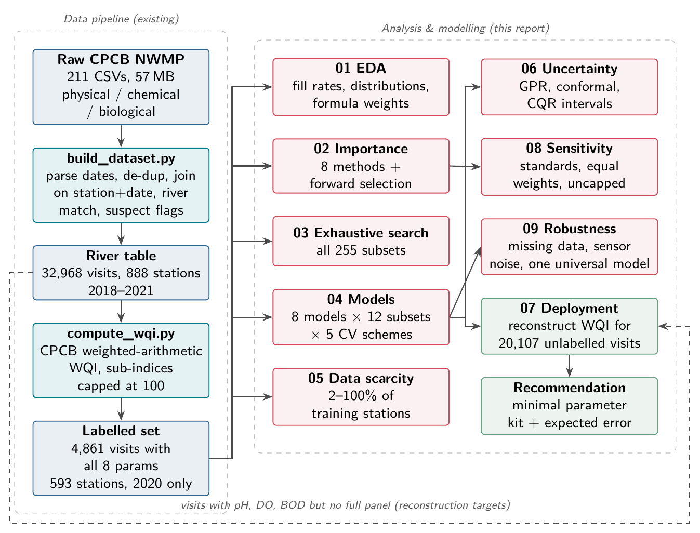
</p>

> **Figure 2.** End-to-end pipeline. Blue/teal: the data pipeline that produces the labelled set. Red: the analyses reported here (script numbers in <code>scripts/</code>). Green: deployment on visits that lack a full panel.

### 3.3 Parameter availability: the full panel exists for one year only

Figure 3 shows, per year, the fraction of river visits that report each of the eight usable parameters. Temperature, COD, TDS, total solids, colour and odour were excluded earlier because each is recorded in under about 6% of rows.

<p align="center">
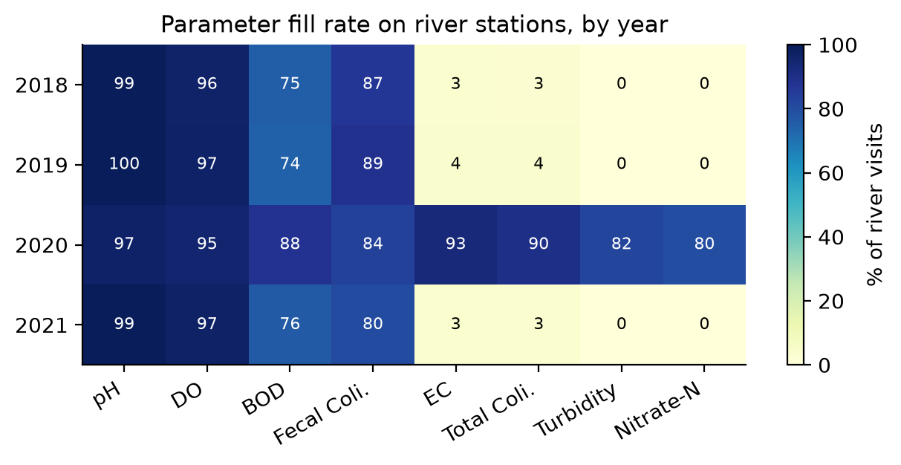
</p>

> **Figure 3.** Fill rate (% of river visits reporting the parameter) by year. pH, DO, BOD and fecal coliform are reported routinely every year. EC, total coliform, turbidity and nitrate-N were reported almost exclusively in 2020.

This is the single most consequential property of the data and was not visible in earlier, pooled fill-rate summaries. pH, DO, BOD and fecal coliform form a *routine panel*, reported on 74–99% of visits in every year. EC, total coliform, turbidity and nitrate-N were reported on 80–93% of visits in 2020 but on 0–4% in 2018, 2019 and 2021. Three consequences follow:

- The ground-truth WQI can be computed only for 2020 visits. A “train on early years, test on later years” split is impossible, so temporal generalisation is examined through a held-out-season scheme instead (Section 5.4).

- Outside 2020, the subsets `S5` and `S7` originally proposed in the project methodology are not actually available at river stations, because EC, total coliform and turbidity are missing there. The routine panel `S4-routine` (pH, DO, BOD, fecal coliform) and its core `S3` (pH, DO, BOD) are what reduced-parameter monitoring looks like in practice.

- The 2018, 2019 and 2021 visits are a natural, real (not simulated) data-scarce deployment target (Section 6.9).

The resulting gap is large (Figure 4). Of 32,968 visits, 24,993 (75.8%) report `S3` and 21,547 (65.4%) the routine four-parameter panel, but only 4,861 (14.7%) report all eight parameters.

<p align="center">
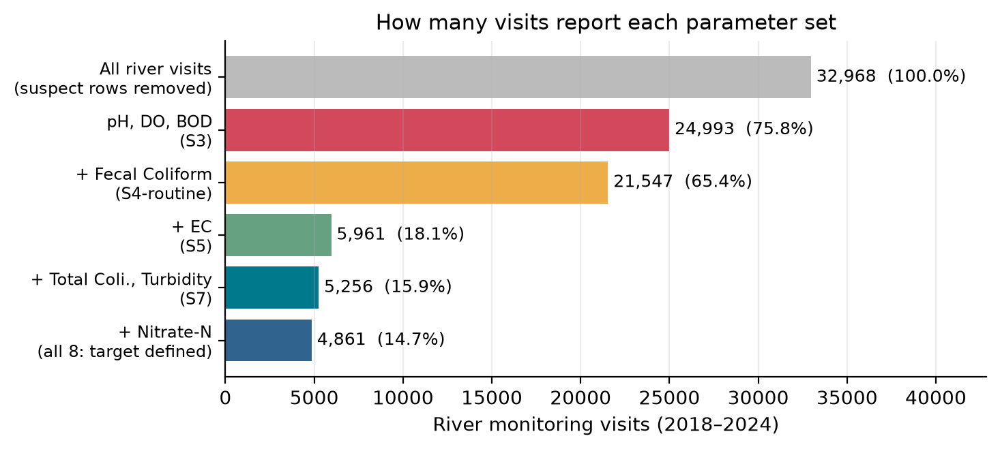
</p>

> **Figure 4.** Availability funnel: number of river visits that report each nested parameter set. Only the last bar carries a computable ground-truth index.

### 3.4 The labelled set

The 4,861 fully-observed visits come from **593 stations on 58 rivers in 21 states**, all in 2020. A station contributes between 1 and 19 visits (median 9). Coverage spans the Himalayan rivers of Himachal Pradesh and Punjab, the Ganga main stem (909 visits), the Deccan rivers (Godavari, Krishna, Cauvery, Tungabhadra) and the central/western rivers (Narmada, Tapi, Mahi, Chambal) (Figure 5). Monsoon months (June–September) contribute 1,819 visits, post-monsoon 1,118, pre-monsoon 1,026 and winter 898.

<p align="center">
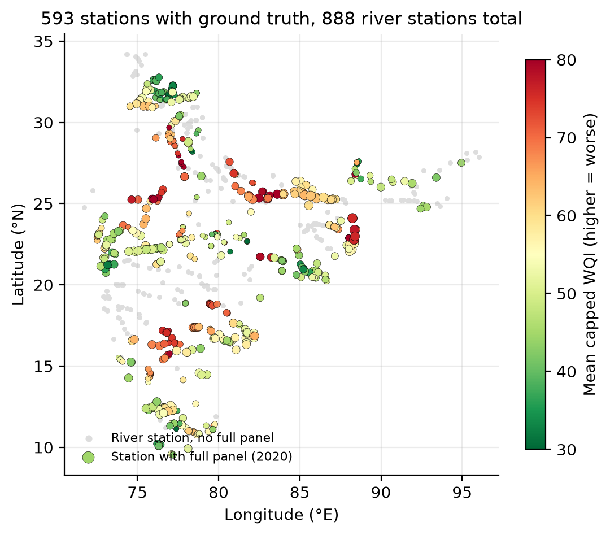
</p>

> **Figure 5.** River stations. Coloured: the 593 stations with full-panel ground truth, coloured by mean capped WQI and sized by number of visits. Grey: river stations without a full panel.

Table 2 summarises the eight parameters. Six of them are extremely right-skewed (skewness 8–35): turbidity ranges up to 3,640 NTU during monsoon silt events, and BOD up to 294 mg/L below a sewage inflow on the Ganga. Figure 6 shows the distributions against each parameter’s standard. Turbidity exceeds its 10 NTU standard on 47.6% of visits, fecal coliform its 500 MPN/100 mL standard on 33.7%, and BOD its 3 mg/L standard on 12.2%.

**Table 2.** Parameter statistics in the labelled set ($`n=4{,}861`$).

| Parameter | Unit | Measurement | Median | 5% | 95% | Max | Skew | % $`>S_i`$ |
|:---|:---|:---|---:|---:|---:|---:|---:|---:|
| pH | – | probe, instant | 7.80 | 7.00 | 8.49 | 8.9 | $`-0.4`$ | 2.9 |
| DO | mg/L | probe, instant | 7.20 | 4.10 | 9.30 | 13.0 | $`-1.1`$ | 7.9 |
| BOD | mg/L | lab, 5 days | 1.70 | 0.20 | 5.00 | 294 | 35.4 | 12.2 |
| Turbidity | NTU | probe, instant | 9.00 | 0.92 | 236 | 3,640 | 9.5 | 47.6 |
| Nitrate-N | mg N/L | kit / lab | 0.50 | 0.06 | 2.70 | 98 | 19.5 | 0.9 |
| Fecal coliform | MPN/100mL | lab, 24–48 h | 130 | 1 | 90,000 | 840,000 | 8.2 | 33.7 |
| EC | µS/cm | probe, instant | 323 | 91 | 1,943 | 61,120 | 8.6 | 10.9 |
| Total coliform | MPN/100mL | lab, 24–48 h | 540 | 32 | 160,000 | 2,400,000 | 12.4 | 22.1 |

<p align="center">
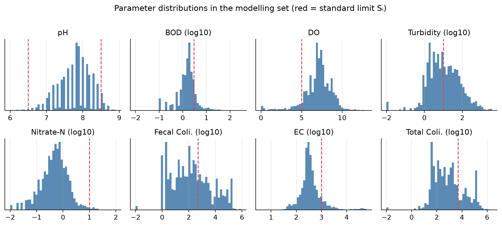
</p>

> **Figure 6.** Parameter distributions in the labelled set. Skewed parameters are shown on a <span class="math inline">log<sub>10</sub></span> axis. Dashed red lines mark the standard <span class="math inline"><em>S</em><sub><em>i</em></sub></span> (for pH, the 6.5–8.5 band).

## 4. Ground-Truth Water Quality Index

### 4.1 Formula

We use the CPCB weighted-arithmetic index (`scripts/compute_wqi.py`). For each parameter $`i`$ a sub-index $`q_i\ge 0`$ is computed, where $`q_i=0`$ is ideal and $`q_i=100`$ means exactly at the standard:
``` math
\begin{aligned}
  q_i &= 100\,\frac{x_i}{S_i} && \text{BOD, coliforms, turbidity, nitrate-N, EC (more is worse)} \\
  q_{\mathrm{DO}} &= 100\,\frac{14.6 - x_{\mathrm{DO}}}{14.6 - 5} && \text{DO (less is worse; 14.6 mg/L = saturation at 0\,°C)} \\
  q_{\mathrm{pH}} &= \begin{cases} 100\,(x_{\mathrm{pH}}-7)/(8.5-7) & x_{\mathrm{pH}}\ge 7 \\ 100\,(7-x_{\mathrm{pH}})/(7-6.5) & x_{\mathrm{pH}}<7 \end{cases} && \text{pH (asymmetric CPCB band)}
\end{aligned}
```
Unit weights are $`W_i = K/S_i`$ with $`K = 1/\sum_j (1/S_j)`$, so that $`\sum_i W_i = 1`$. For pH the band width $`8.5-6.5=2`$ serves as $`S_i`$. The index is
``` math
\mathrm{WQI}= \frac{\sum_i W_i\, \min(q_i, 100)}{\sum_i W_i}.
  \tag{4}
```

**Table 3.** Standard values and resulting unit weights. The four CPCB primary bathing-water criteria carry high confidence; the other four are commonly used secondary thresholds.

| Parameter | Standard $`S_i`$ | Ideal | Source | Weight $`W_i`$ |
|:---|:---|---:|:---|---:|
| pH | 6.5–8.5 (band 2.0) | 7.0 | CPCB bathing criteria | 0.4049 |
| BOD | 3 mg/L | 0 | CPCB bathing criteria | 0.2699 |
| DO | 5 mg/L | 14.6 | CPCB bathing criteria | 0.1620 |
| Turbidity | 10 NTU | 0 | river-WQI literature | 0.0810 |
| Nitrate-N | 10.16 mg N/L | 0 | BIS 45 mg/L NO$`_3^-`$, converted | 0.0797 |
| Fecal coliform | 500 MPN/100mL | 0 | CPCB bathing criteria | 0.0016 |
| EC | 1000 µS/cm | 0 | river-WQI literature (weakest) | 0.0008 |
| Total coliform | 5000 MPN/100mL | 0 | river-WQI literature | 0.0002 |

### 4.2 Why the sub-indices are capped

With the textbook uncapped formula the index is dominated by a few genuine extremes. Turbidity of 3,640 NTU at the Mahi during a monsoon flood gives $`q_{\text{Turb}}=36{,}400`$ and an index of 3,007. BOD of 294 mg/L on the Ganga near Munger gives an index of 2,716. The uncapped index has mean 108, median 65 and standard deviation 175 (Figure 7). Capping each $`q_i`$ at 100, i.e. treating “beyond the standard” as “violation” without further extrapolation, is standard practice. It gives a well-behaved target with mean 56.1, standard deviation 14.1 and range 13.7–92.6. Because the capped index is a weighted mean of values in $`[0,100]`$, it cannot exceed 100, so the “Unsuitable” class ($`>100`$) is structurally empty. The uncapped variant is analysed separately in Section 6.8.

<p align="center">
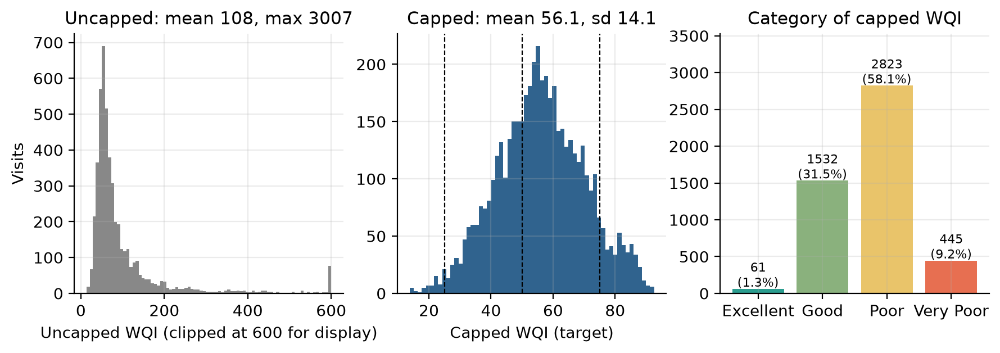
</p>

> **Figure 7.** Left: uncapped index (clipped at 600 for display). Middle: capped index, the regression target, with category boundaries. Right: category distribution of the target. “Poor” (51–75) is the majority class at 58.1%.

The target categories are Excellent (≤25): 61 visits (1.3%), Good (26–50): 1,532 (31.5%), Poor (51–75): 2,823 (58.1%) and Very Poor (76–100): 445 (9.2%). A classifier that always predicts “Poor” would therefore score 58.1% category accuracy. This is the baseline that category accuracies in Section 6 should be read against.

### 4.3 What actually drives the index

Because Eq. (4) is linear in the capped sub-indices, its variance decomposes *exactly*:
``` math
\operatorname{Var}(\mathrm{WQI}) = \sum_i \operatorname{Cov}\!\left(W_i \tilde q_i,\; \mathrm{WQI}\right), \qquad \tilde q_i=\min(q_i,100),
```
so $`\operatorname{Cov}(W_i\tilde q_i,\mathrm{WQI})/\operatorname{Var}(\mathrm{WQI})`$ is the share of index variance attributable to parameter $`i`$, and the shares sum to one. Figure 8 shows the three ingredients: the unit weight, the spread of the capped sub-index, and the resulting variance share.

<p align="center">
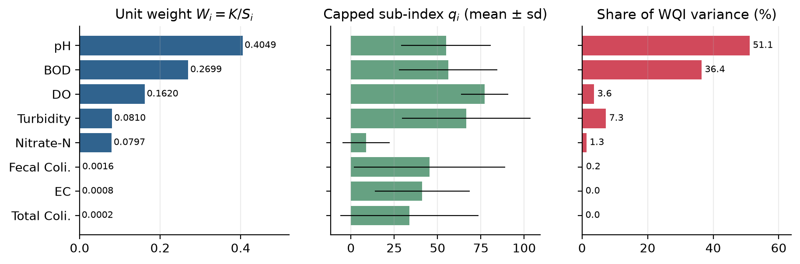
</p>

> **Figure 8.** Left: unit weights <span class="math inline"><em>W</em><sub><em>i</em></sub> = <em>K</em>/<em>S</em><sub><em>i</em></sub></span>. Middle: mean <span class="math inline">±</span> s.d. of the capped sub-indices. Right: exact share of target variance per parameter. pH and BOD account for 87.5% of the variance; fecal coliform, EC and total coliform together for 0.24%.

> **Finding 1: the CPCB weights make three of the eight parameters almost irrelevant**
>
> pH explains 51.1% of the index variance, BOD 36.4%, turbidity 7.3%, DO 3.6% and nitrate-N 1.3%. Fecal coliform (0.19%), EC (0.04%) and total coliform (0.02%) are almost irrelevant. The reason is arithmetic, not hydrological. A weight of $`1/S_i`$ rewards parameters whose standard is a *small number in its unit*: 2 pH units or 3 mg/L, versus 500 or 5,000 MPN/100 mL. Fecal coliform exceeds its standard on a third of visits and still cannot move the index.

This has two consequences that shape the rest of the report. First, it predicts that adding fecal coliform and EC to `S3` (to form the originally proposed `S5`) will barely improve accuracy, and that turbidity and nitrate-N are the parameters worth adding. Second, it means the CPCB-weighted index is effectively blind to bacterial contamination. A reduced-parameter model that reproduces the index faithfully inherits that blindness. We return to this public-health caveat in Section 7, and test the alternative of equal weights in Section 6.8.

Two further conventions inflate the index for ordinary river water. A typical river pH of 7.8 scores $`q_{\mathrm{pH}}=53`$ because the ideal is 7.0. A healthy DO of 7.2 mg/L scores $`q_{\mathrm{DO}}=77`$ because the ideal is 14.6 mg/L, the saturation value at 0 °C. These conventions are why 67% of visits fall in Poor or Very Poor even though only 12% exceed the BOD standard. The categories are therefore best read as relative positions on this particular scale, not as absolute verdicts.

## 5. Methodology

### 5.1 Problem formulation

Let $`x\in\mathbb{R}^8`$ be the parameter vector of a visit and $`y=g(x)`$ its capped WQI (Eq. (4)). For a parameter subset $`S\subseteq\{1,\dots,8\}`$ we learn $`f_S:\mathbb{R}^{|S|}\to\mathbb{R}`$ minimising squared error on training visits. We evaluate $`f_S(x_S)`$ against the fixed $`y`$ on held-out visits. The irreducible error of $`f_S`$ is the part of $`y`$ that depends on the unobserved parameters $`x_{\bar S}`$ and cannot be inferred from $`x_S`$ through their correlations.

### 5.2 Parameter subsets

Table 4 lists the twelve named subsets. The first four (`S3`, `S5`, `S7`, `Full-8`) were fixed *before* any modelling, from pooled fill rates, in the project methodology. They are kept unchanged so that the original plan can be assessed. The others were added in this study for three reasons: `S4-routine` reflects the panel actually reported every year (Section 3.3); the `I`-subsets follow the importance analysis (Section 6.1); and the `Sensor` subsets contain only parameters measurable instantly with field probes. In addition, all $`2^8-1=255`$ subsets are evaluated with XGBoost (Section 6.2).

**Table 4.** Named parameter subsets. “Lab” marks inputs that need laboratory incubation or culturing.

| Name | Parameters | *k* | Rationale |
|:---|:---|:--:|:---|
| `S3` | pH, DO, BOD (lab) | 3 | Pre-registered: best-covered parameters |
| `S4-routine` | pH, DO, BOD, fecal coliform (lab) | 4 | Panel actually reported every year |
| `S5` | `S4-routine` + EC | 5 | Pre-registered |
| `S7` | `S5` + total coliform, turbidity | 7 | Pre-registered |
| `Full-8` | all eight | 8 | Ceiling |
| `I3-importance` | pH, BOD, turbidity | 3 | Forward selection, first three |
| `I4-importance` | pH, BOD, turbidity, DO | 4 | Forward selection, first four |
| `I5-importance` | `I4` + nitrate-N | 5 | Forward selection, first five |
| `Sensor-3` | pH, DO, EC | 3 | Probe-only, no laboratory |
| `Sensor-4` | pH, DO, EC, turbidity | 4 | Probe-only, no laboratory |
| `S3+context` | `S3` + latitude, longitude, month | 3+4 | Can location/season stand in for missing parameters? |
| `S4-routine+context` | `S4-routine` + latitude, longitude, month | 4+4 | As above |

### 5.3 Models

Eight model families are compared, from no-ML to flexible non-parametric (Table 5; full hyper-parameters in Appendix A). Hyper-parameters are fixed *a priori* for every subset and training size. They are not tuned per fold, so that differences between subsets are not confounded with differences in tuning effort. For distance-based and linear models, the six heavy-tailed parameters are transformed with $`\log(1+x)`$ and all inputs are standardised. Tree models receive raw values.

**Table 5.** Model families.

| Model | Description |
|:---|:---|
| **Formula** (no ML) | Eq. (4) computed from the available parameters only, with weights renormalised over them. This is what a practitioner would do without a model (equivalent to the descriptive `WQI_partial`). |
| Linear | Ordinary least squares on log-transformed, standardised inputs. |
| *k*NN | $`k=10`$ nearest neighbours, distance-weighted. |
| SVR | RBF support-vector regression, $`C=30`$, $`\varepsilon=0.5`$. |
| MLP | Two hidden layers (64, 32), L2 $`10^{-3}`$, early stopping. |
| Random forest | 400 trees, min. leaf size 2 \[3\]. |
| XGBoost | 600 boosted trees, depth 5, learning rate 0.03, subsampling 0.8 \[6\]. |
| GPR | Gaussian process, ARD-RBF + white-noise kernel, fitted on at most 1,500 random training rows (subset-of-data approximation) \[14\]. |

### 5.4 Validation schemes

The research question is about *data-scarce* systems, i.e. places the model has not been trained on. A random split of visits would let a model memorise station identity, since visits from one station are strongly correlated. We therefore use five schemes of increasing difficulty (Figure 9):

1.  **Random rows** (5-fold): optimistic reference only.

2.  **Unseen stations** (5-fold grouped by station): *the primary scheme*. Every test station is absent from training, which mimics deploying at a new site. All headline numbers use this scheme.

3.  **Unseen rivers** (5-fold grouped by river): a whole river is held out.

4.  **Unseen states** (5-fold grouped by state): regional transfer.

5.  **Unseen season** (leave-one-season-out: winter, pre-monsoon, monsoon, post-monsoon): the closest available proxy for temporal transfer, since a year-based split is impossible (Section 3.3).

<p align="center">
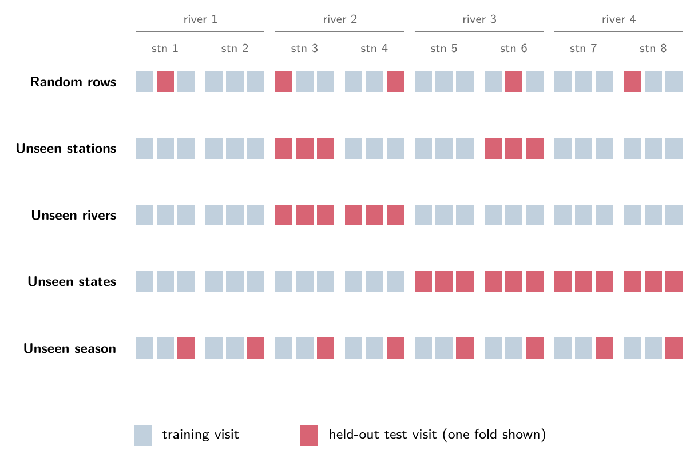
</p>

> **Figure 9.** Illustration of the five validation schemes on a toy set of 8 stations on 4 rivers. Red cells are held out in one fold. Only the random-rows scheme lets a test station appear in training.

Predictions are collected out-of-fold, so every labelled visit is predicted exactly once by a model that never saw it (or its station, river, state or season), and metrics are computed on the pooled predictions. Fold-to-fold standard deviations are reported alongside.

### 5.5 Metrics

On held-out data we report the coefficient of determination R² (identical to the Nash–Sutcliffe efficiency, NSE \[12\]), RMSE and MAE in WQI points, and KGE \[8\]. We also report **category accuracy** (exact match among Excellent/Good/Poor/Very Poor), macro-F1 over categories, the share of predictions within $`\pm 5`$ points, and the share off by two or more categories. For reference, the target’s standard deviation is 14.1 points, so RMSE $`=14.1`$ corresponds to R² = 0. A category is 25 points wide.

### 5.6 Further experiments

**Importance (Section 6.1).** Spearman correlation, mutual information \[10\], random-forest impurity, XGBoost gain, permutation importance on held-out stations, mean absolute SHAP value \[11\], drop-column importance (station-CV R² lost when a parameter is removed and the model retrained), and the analytic variance share of Section 4.3. A consensus rank is the mean of the eight ranks. Greedy forward selection then adds, at each step, the parameter that most increases station-CV R².

**Data scarcity (Section 6.5).** Inside each station-held-out fold, only a random fraction $`\phi\in\{2,5,10,25,50,100\}\%`$ of the *training stations* is kept. The test stations stay fixed. Subsampling stations rather than visits reflects how scarcity arises in practice: few monitored sites, not fewer visits per site. Each $`\phi<100\%`$ is repeated with three random seeds, giving 15 fits per (model, subset, $`\phi`$).

**Uncertainty (Section 6.6).** At a nominal 90% level we compare (i) Gaussian intervals from the GPR predictive standard deviation, (ii) split-conformal intervals around XGBoost \[19, 2\], whose half-width is the 90% quantile of absolute residuals from an inner station-grouped CV on the training fold, and (iii) conformalised quantile regression (CQR \[16\]) with XGBoost 5%/95% quantile models. We report empirical coverage, mean width and coverage by subgroup.

**Robustness (Section 6.7).** (A) A single “universal” XGBoost trained on copies of the training data with random parameter masking (50% drop rate, missing values as NaN), compared with a dedicated model per subset. (B) Random missingness of 0–50% of readings at test time, handled by native NaN support, mean imputation or iterative (MICE-style) imputation. (C) Gaussian measurement noise on test inputs at multiples of typical field error. Absolute noise is used for pH ($`\sigma=0.1`$) and DO ($`\sigma=0.3`$ mg/L), and multiplicative noise for the rest (BOD 15%, turbidity 10%, nitrate 15%, EC 5%, coliforms 50%).

**Sensitivity (Section 6.8).** The index is recomputed (A) with each standard $`S_i`$ halved and doubled, plus an EC sweep from 250 to 4,000 µS/cm; (B) with equal weights $`W_i=1/8`$; and (C) uncapped, predicted on a $`\log_{10}`$ scale. Key experiments are re-run on each variant.

**Deployment (Section 6.9).** `S3` and `S4-routine` XGBoost models are trained on all 4,861 labelled visits and applied to every river visit with `S3` available but no full panel. Covariate shift is checked with Kolmogorov–Smirnov tests and with adversarial validation: a classifier trained to separate labelled from deployment visits, where an AUC near 0.5 means indistinguishable.

### 5.7 Reproducibility

All experiments are deterministic (seed 42) and are run by the numbered scripts in `scripts/` (Appendix C). The software was Python 3.14, pandas 3.0, scikit-learn 1.9, XGBoost 3.4 and SHAP 0.54, on a 16-core CPU. No GPU is needed: the largest experiment takes under an hour.

## 6. Results

Unless stated otherwise, every number below is computed on **unseen stations** (5-fold station-grouped CV, pooled out-of-fold predictions). The target standard deviation is 14.1 WQI points, and the majority-class category baseline is 58.1%.

### 6.1 Which parameters matter? (RQ1)

Table 6 and Figure 10 report eight importance measures for the full eight-parameter problem.

**Table 6.** Parameter importance by eight methods, sorted by consensus (mean) rank. Permutation and drop-column importances are R² losses on unseen stations. SHAP is in WQI points. Variance share is from the exact decomposition of Section 4.3.

| Parameter | $`|\rho_S|`$ | MI | RF | XGB gain | Perm. | SHAP | Drop-col. | Var. share | Rank |
|:---|---:|---:|---:|---:|---:|---:|---:|---:|---:|
| pH | 0.62 | 0.40 | 0.494 | 0.382 | 1.077 | 8.20 | 0.366 | 0.511 | 1.25 |
| BOD | 0.65 | 0.35 | 0.441 | 0.440 | 0.598 | 6.75 | 0.109 | 0.364 | 1.75 |
| Turbidity | 0.33 | 0.09 | 0.039 | 0.060 | 0.084 | 2.56 | 0.023 | 0.073 | 3.75 |
| DO | 0.24 | 0.09 | 0.015 | 0.050 | 0.045 | 1.56 | 0.011 | 0.036 | 4.63 |
| Nitrate-N | 0.14 | 0.06 | 0.006 | 0.020 | 0.009 | 0.47 | 0.003 | 0.013 | 5.75 |
| EC | 0.32 | 0.14 | 0.003 | 0.017 | 0.000 | 0.08 | 0.000 | 0.000 | 6.13 |
| Fecal coliform | 0.38 | 0.12 | 0.002 | 0.016 | 0.000 | 0.08 | 0.000 | 0.002 | 6.25 |
| Total coliform | 0.38 | 0.13 | 0.001 | 0.017 | 0.000 | 0.07 | 0.000 | 0.000 | 6.50 |

<p align="center">
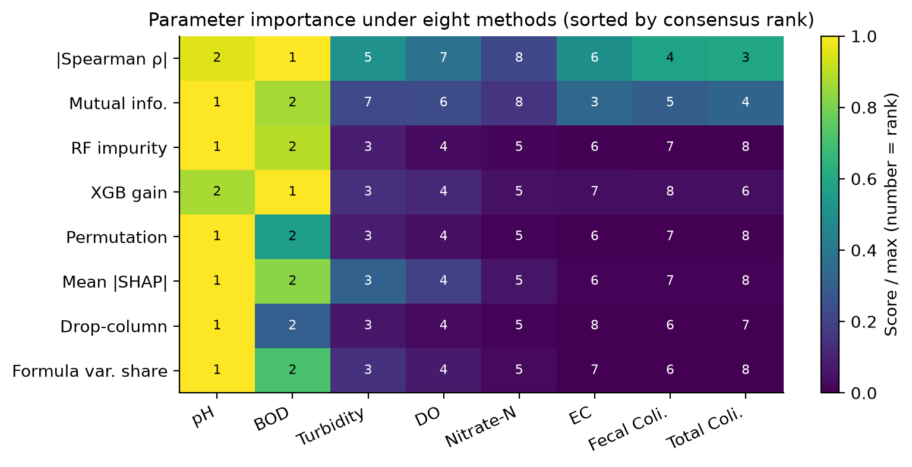
</p>

> **Figure 10.** Normalised importance (colour) and rank (number) of each parameter under eight methods. The six model-based and analytic methods agree exactly on the order pH <span class="math inline">&gt;</span> BOD <span class="math inline">&gt;</span> turbidity <span class="math inline">&gt;</span> DO <span class="math inline">&gt;</span> nitrate-N. Only the two marginal-association measures (Spearman, mutual information) rank the coliforms and EC highly.

**Agreement.** All six methods that measure a parameter’s *contribution to the prediction* give the same top-five order: pH, BOD, turbidity, DO, nitrate-N. These are RF impurity, XGBoost gain, permutation, SHAP, drop-column and the analytic variance share. The order matches the analytic decomposition of the formula exactly, which validates the ML-based measures: they recover the known structure.

**Correlation is not importance.** Spearman correlation and mutual information rank fecal and total coliform third and fourth, ahead of turbidity and DO, with $`\rho_S\approx0.38`$. Yet removing either coliform from the full model costs no measurable R² (drop-column $`<10^{-4}`$). The coliforms correlate with the index only because sewage raises BOD and coliforms together (Figure 11a). Their information is redundant given BOD, and their own weight in the formula is negligible. Selecting parameters by correlation alone, as is common in the literature, would therefore have picked the wrong subsets.

<p align="center">
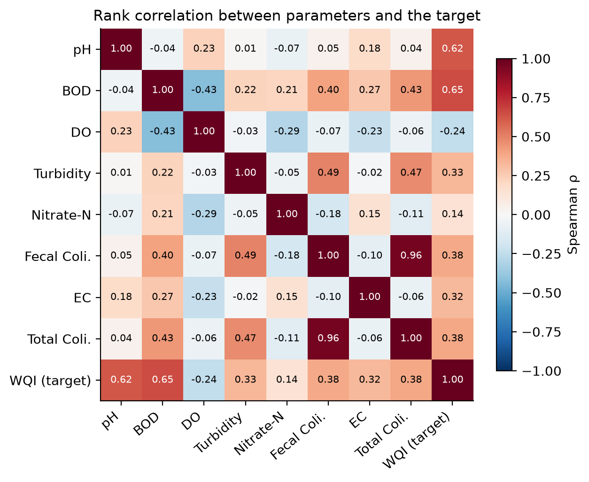
</p>

> **Figure 11b.** Spearman correlations.
<p align="center">
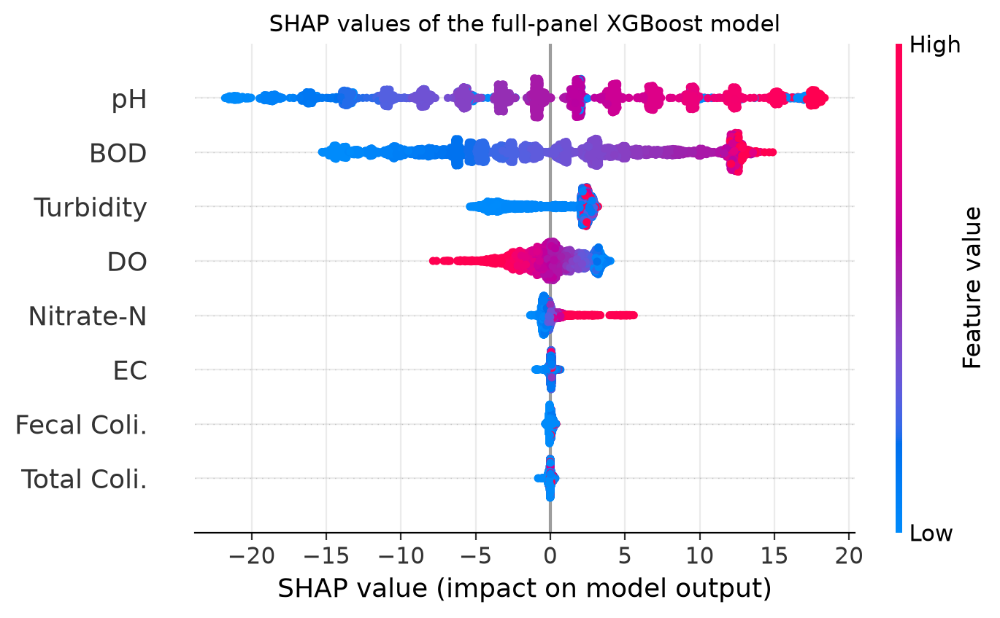
</p>

> **Figure 11b.** SHAP values of the full model.
<figcaption>(a) BOD, fecal and total coliform, turbidity and EC form a correlated “pollution” block (<span class="math inline"><em>ρ</em><sub><em>S</em></sub> = 0.3</span>–0.8), which explains why the coliforms correlate with the index without contributing to it. (b) High pH and high BOD push the prediction up by up to <span class="math inline">∼</span>20 points; the coliforms and EC have SHAP values near zero for every visit.</figcaption>
</figure>

**The model recovers the formula’s shape.** The SHAP dependence plots (Figure 12) show the piecewise-linear capped sub-indices: a V-shape around pH 7 that is steeper below 7 (the asymmetric band), and a linear rise in BOD that saturates at 3 mg/L (the cap at $`q=100`$). Turbidity likewise saturates at 10 NTU, and DO falls linearly.

<p align="center">
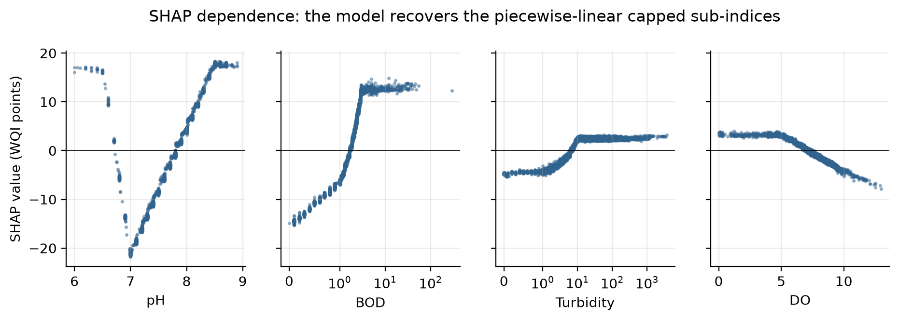
</p>

> **Figure 12.** SHAP dependence for the four main drivers. Saturation at BOD = 3 mg/L and turbidity = 10 NTU is the sub-index cap; the asymmetric V around pH 7 is the CPCB 6.5–8.5 band.

**Forward selection.** (Figure 13) adds parameters in exactly the consensus order. R² rises 0.508 (pH) → 0.939 (+BOD) → 0.977 (+turbidity) → 0.993 (+DO) → 0.998 (+nitrate-N), and adding EC and the coliforms afterwards slightly *lowers* it, to 0.997, because they only add noise.

<p align="center">
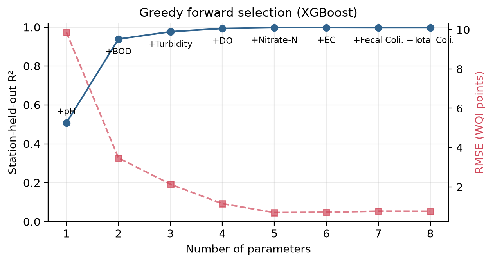
</p>

> **Figure 13.** Greedy forward selection with XGBoost on unseen stations. Five parameters reach the ceiling; the last three add nothing.

> **Finding 2**
>
> The information in the CPCB index is concentrated in **pH and BOD** (R² = 0.94 from these two alone), with **turbidity, DO and nitrate-N** completing it. Fecal coliform, total coliform and EC are statistically associated with the index but carry no usable additional information for it.

### 6.2 How few parameters are enough? (RQ2)

Figure 14 shows the station-held-out R² of all 255 subsets.

<p align="center">
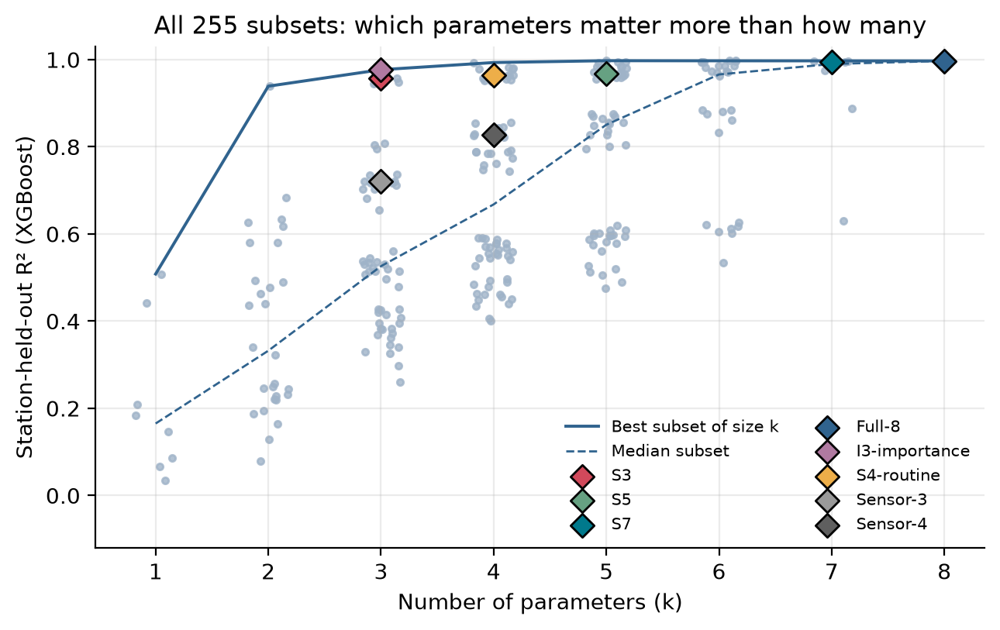
</p>

> **Figure 14.** All 255 parameter subsets (grey points, jittered) by size <span class="math inline"><em>k</em></span>. Solid line: best subset of each size; dashed: median. Diamonds: named subsets. At every <span class="math inline"><em>k</em> ≤ 5</span> the spread between best and worst subset is far larger than the gain from adding a parameter.

**Which beats how many.** At $`k=3`$, R² ranges from 0.26 to 0.98 depending on which three parameters are chosen; at $`k=4`$ from 0.40 to 0.99. The *best* three-parameter subset (0.977) beats the *median* six-parameter subset (0.966). The ceiling is reached at $`k=5`$ (0.998). Table 7 lists the best subset at each size, and Figure 15 shows the top three per size: every top subset contains pH and BOD.

**Table 7.** Best subset of each size (XGBoost, unseen stations).

| *k* | Best subset                       | R² | RMSE | Cat. acc. |
|------:|:----------------------------------|--------:|-----:|----------:|
|     1 | pH                                |   0.508 | 9.86 |     68.3% |
|     2 | pH, BOD                           |   0.939 | 3.47 |     89.3% |
|     3 | pH, BOD, turbidity                |   0.977 | 2.14 |     94.0% |
|     4 | pH, BOD, DO, turbidity            |   0.993 | 1.15 |     96.8% |
|     5 | pH, BOD, DO, turbidity, nitrate-N |   0.998 | 0.69 |     97.8% |
|     6 | \+ EC                             |   0.997 | 0.73 |     97.9% |
|     7 | \+ fecal & total coliform (no EC) |   0.997 | 0.74 |     97.9% |
|     8 | all                               |   0.997 | 0.76 |     97.8% |

<p align="center">
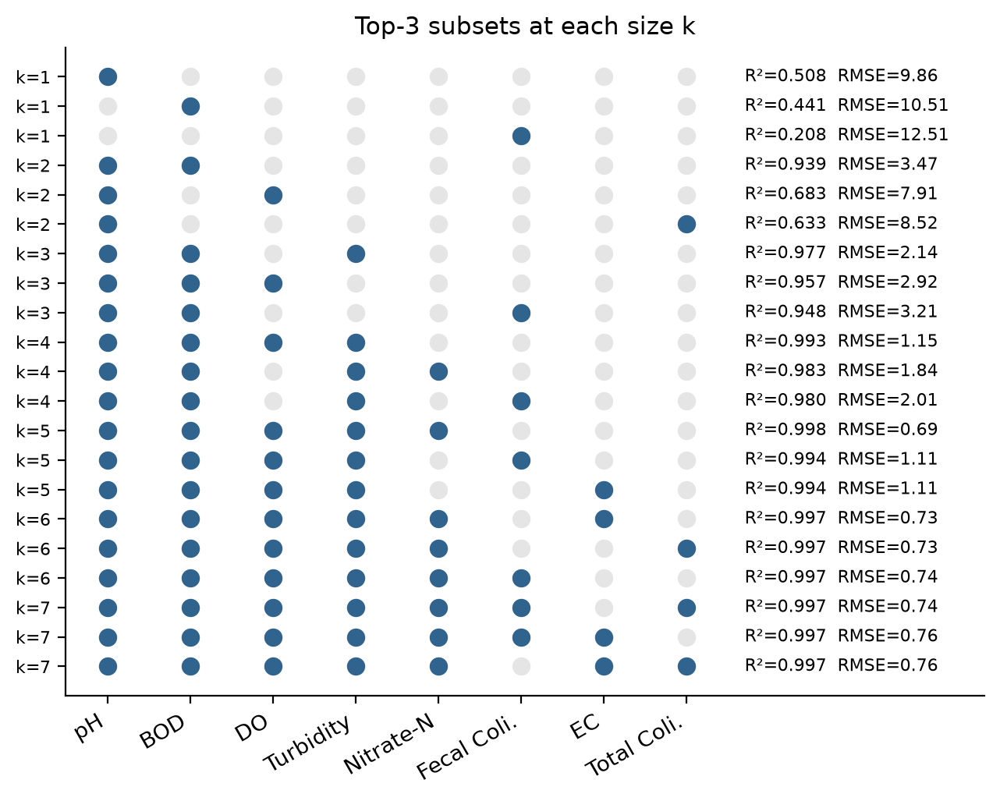
</p>

> **Figure 15.** The three best subsets at each size (filled = parameter included).

**How the pre-registered subsets fare.** `S3` (pH, DO, BOD) is the 2nd-best of 56 three-parameter subsets (R² = 0.957), so the availability-based choice was a good one. `S5` ranks only 13th of 56 five-parameter subsets: its two extra parameters, fecal coliform and EC, are the near-weightless ones. `S7` ranks 4th of 8 (0.994), because it contains turbidity but misses nitrate-N. The probe-only `Sensor-3` (pH, DO, EC; R² = 0.72) and `Sensor-4` (+turbidity; 0.83) are far behind, because they lack BOD, the second-largest driver of the index.

**ML versus re-weighting the formula.** The obvious no-ML alternative is to evaluate Eq. (4) over the available parameters with renormalised weights. Figure 16 compares it with XGBoost for all 255 subsets. The model is better for every subset that misses a parameter with non-negligible weight, and the gap is large exactly where it matters. For `S3`, R² is 0.863 with the formula and 0.957 with XGBoost, and RMSE falls from 5.21 to 2.93. For `Sensor-4` it is 0.389 versus 0.828. The model learns the *expected* contribution of the missing parameters conditional on the observed ones, while the formula implicitly assumes the missing parameters behave like the observed ones. Only when the missing parameters are the weightless coliforms and EC (`I5`, `Full-8`) is the formula essentially exact, since then nothing is missing that matters.

<p align="center">
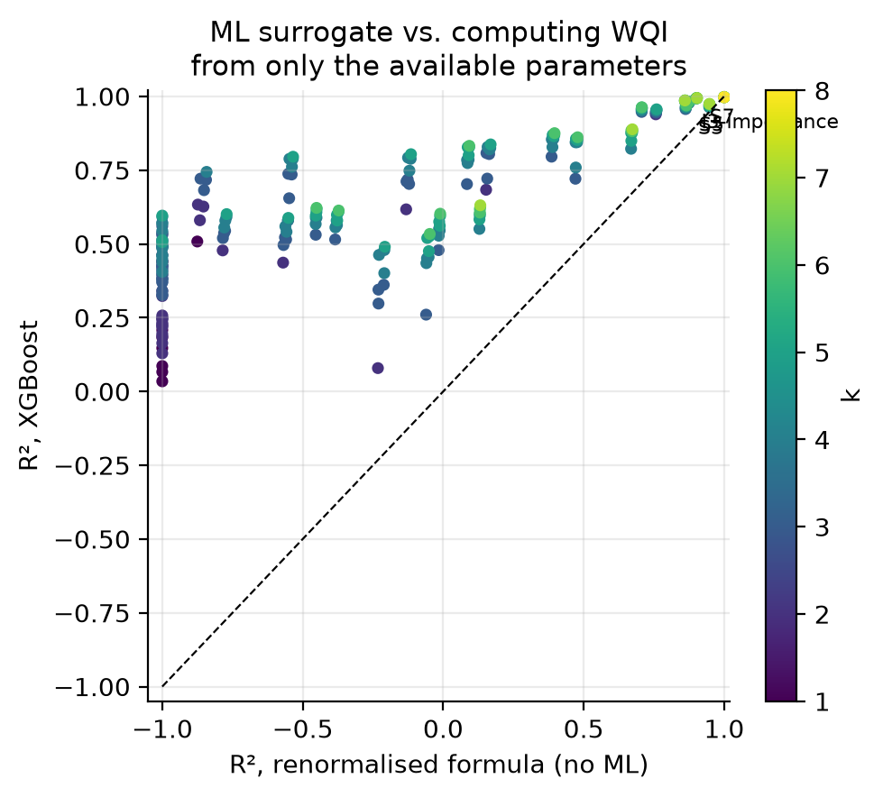
</p>

> **Figure 16.** R<span class="math inline"><sup>2</sup></span> of XGBoost against R<span class="math inline"><sup>2</sup></span> of the renormalised formula, for every subset (colour = <span class="math inline"><em>k</em></span>). Points above the diagonal are subsets where learning beats re-weighting; that is almost all of them.

### 6.3 Model comparison

Figure 17 shows R² for every model and subset, and Table 8 gives the full metrics for the best model, XGBoost.

<p align="center">
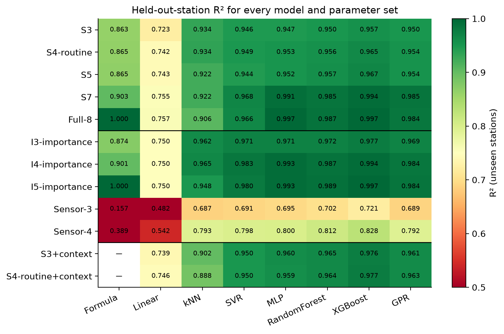
</p>

> **Figure 17.** Station-held-out R<span class="math inline"><sup>2</sup></span> for 8 models <span class="math inline">×</span> 12 subsets. Rows: pre-registered/routine subsets (top), importance and sensor subsets (middle), subsets with location and month context (bottom).

**Table 8.** XGBoost on unseen stations (mean ± s.d. across the 5 folds for R², RMSE and category accuracy). “±5” = share of predictions within 5 WQI points. No reduced-parameter prediction was ever two or more categories away from the truth.

| Subset | *k* | R² (=NSE) | RMSE | MAE | KGE | Cat. acc. | ±5 |
|:---|---:|---:|---:|---:|---:|---:|---:|
| `S3` | 3 | 0.957 ± .006 | 2.93 ± .11 | 2.42 | 0.968 | 90.6 ± 0.3% | 92.3% |
| `S4-routine` | 4 | 0.965 ± .004 | 2.65 ± .10 | 2.07 | 0.970 | 91.8 ± 0.8% | 94.0% |
| `S5` | 5 | 0.967 ± .004 | 2.56 ± .08 | 1.96 | 0.971 | 92.3 ± 1.0% | 94.1% |
| `S7` | 7 | 0.994 ± .001 | 1.08 ± .07 | 0.70 | 0.989 | 97.0 ± 1.2% | 99.3% |
| `Full-8` | 8 | 0.997 ± .001 | 0.76 ± .05 | 0.53 | 0.990 | 97.8 ± 0.6% | 99.9% |
| `I3-importance` | 3 | 0.977 ± .003 | 2.14 ± .08 | 1.58 | 0.980 | 94.0 ± 1.2% | 97.1% |
| `I4-importance` | 4 | 0.994 ± .001 | 1.13 ± .10 | 0.74 | 0.988 | 96.8 ± 1.0% | 99.3% |
| `I5-importance` | 5 | 0.998 ± .000 | 0.70 ± .04 | 0.49 | 0.990 | 97.7 ± 0.7% | 99.9% |
| `Sensor-3` | 3 | 0.721 ± .040 | 7.42 ± .41 | 5.81 | 0.797 | 77.5 ± 1.1% | 52.8% |
| `Sensor-4` | 4 | 0.828 ± .022 | 5.82 ± .25 | 4.46 | 0.875 | 82.4 ± 0.9% | 64.9% |
| `S3+context` | 7 | 0.976 ± .003 | 2.17 ± .04 | 1.58 | 0.977 | 93.3 ± 0.8% | 96.5% |
| `S4-routine+context` | 8 | 0.977 ± .003 | 2.12 ± .02 | 1.55 | 0.978 | 93.9 ± 0.8% | 96.7% |

**Ranking of models.** XGBoost is the best or joint-best model for every subset. Random forest, MLP and GPR follow within 0.005–0.01 R² on the reduced subsets, and SVR and *k*NN a little further behind. The model family matters far less than the parameter subset: for `S3`, the five flexible models span R² = 0.934–0.957, whereas changing the subset at fixed model spans 0.72–0.998. Two models are clearly unsuitable:

- **Linear regression** (R² ≈ 0.72–0.76 for every subset) cannot represent the piecewise-linear, capped, V-shaped sub-indices, especially after the log transforms. It is worse than the plain formula wherever the formula has the relevant parameters.

- ***k*NN** degrades as parameters are *added* (0.934 for `S3` to 0.906 for `Full-8`). The uninformative coliform and EC dimensions dilute its distance metric, a textbook curse-of-dimensionality effect.

**Accuracy versus parameter count.** (Figure 18). For the flexible models, RMSE falls only slightly from `S3` to `S5` (2.93 → 2.56 for XGBoost) and then sharply at `S7` (1.08), the first pre-registered subset to include turbidity. Category accuracy follows the same pattern: 90.6%, 91.8%, 92.3%, 97.0%, 97.8%. Every reduced model is far above the 58% majority baseline.

<p align="center">
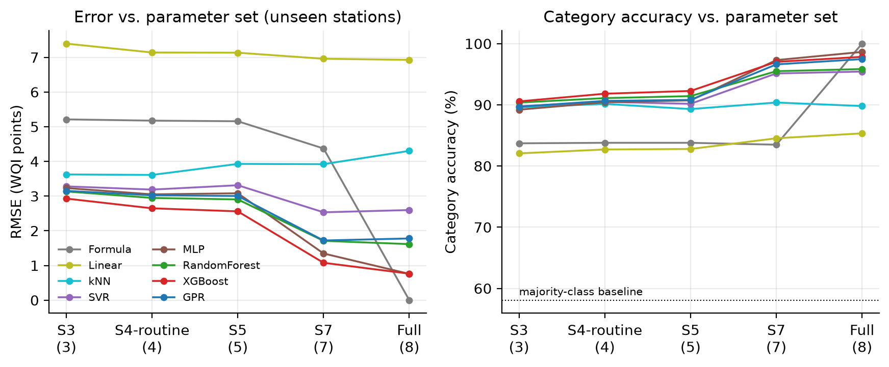
</p>

> **Figure 18.** RMSE (left) and category accuracy (right) against the pre-registered subsets, for each model. The formula reaches zero error only at <code>Full-8</code>, where it <em>is</em> the target.

**What the errors look like.** Figure 19 plots predictions against the truth. The `S3` model shows mild regression to the mean: it slightly over-predicts clean sites and under-predicts the worst. The confusion matrices (Figure 20) show that all category errors occur between adjacent classes, mostly Good↔Poor. Figure 21 explains the `S3` error. Its residual is almost exactly the negative of the unseen parameters’ contribution to the index ($`r=-0.81`$). The model fills in the *average* turbidity/nitrate contribution of about 6 points, so its error is largest when turbidity is atypically low (clear water) or capped (silt-laden water).

<p align="center">
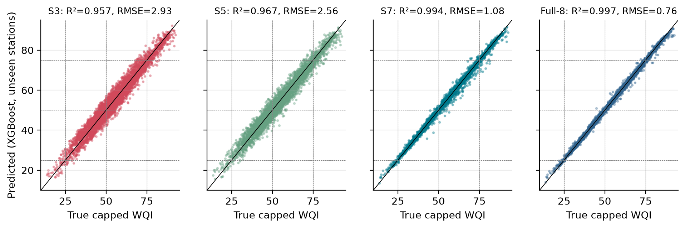
</p>

> **Figure 19.** Predicted against true WQI for XGBoost on unseen stations. Dashed lines are category boundaries.

<p align="center">
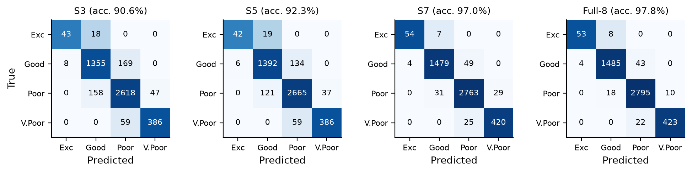
</p>

> **Figure 20.** Category confusion matrices (counts) for XGBoost on unseen stations. Every error is to an adjacent category.

<p align="center">
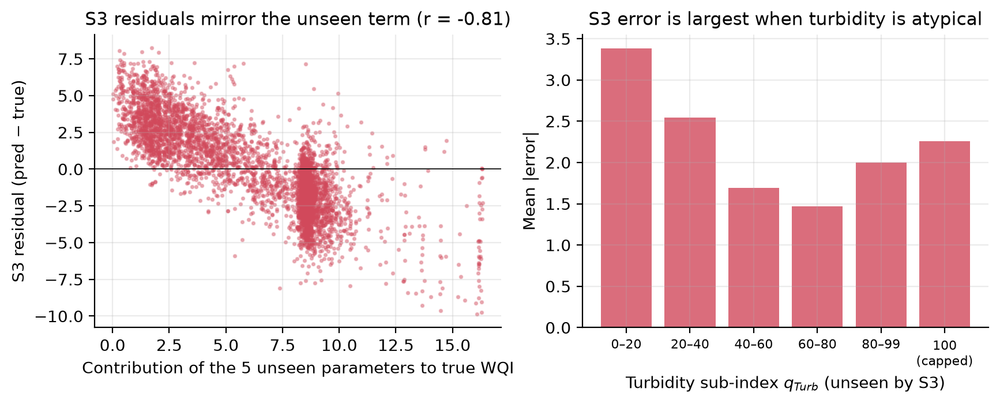
</p>

> **Figure 21.** Anatomy of the <code>S3</code> error. Left: residual against the true contribution of the five unseen parameters. Right: mean absolute error by turbidity sub-index.

**Location and season as free extra inputs.** Adding latitude, longitude and month, which every station knows for free, raises `S3` from R² = 0.957 to 0.976 (RMSE 2.93 → 2.17) and `S4-routine` to 0.977. That is almost exactly what measuring turbidity instead of DO achieves (`I3`, 0.977), at zero measurement cost. The context features let the model learn where and when turbidity is typically high: monsoon months, and the silt-laden rivers of the Indo-Gangetic plain. This is achieved on *unseen stations*, so the model is learning regional and seasonal patterns, not memorising stations.

### 6.4 Generalisation beyond the training stations

Table 9 and Figure 22 compare the five validation schemes.

**Table 9.** XGBoost R² / RMSE under the five validation schemes.

| Subset | Random rows | Unseen stations | Unseen rivers | Unseen states | Unseen season |
|:---|:--:|:--:|:--:|:--:|:--:|
| `S3` | 0.958 / 2.87 | 0.957 / 2.93 | 0.942 / 3.38 | 0.943 / 3.35 | 0.949 / 3.18 |
| `S4-routine` | 0.967 / 2.57 | 0.965 / 2.65 | 0.947 / 3.25 | 0.941 / 3.41 | 0.957 / 2.93 |
| `S5` | 0.969 / 2.46 | 0.967 / 2.56 | 0.948 / 3.21 | 0.942 / 3.40 | 0.959 / 2.85 |
| `S7` | 0.995 / 1.03 | 0.994 / 1.08 | 0.991 / 1.31 | 0.990 / 1.41 | 0.993 / 1.20 |
| `Full-8` | 0.997 / 0.73 | 0.997 / 0.76 | 0.995 / 0.95 | 0.995 / 0.99 | 0.996 / 0.85 |
| `I3-importance` | 0.978 / 2.09 | 0.977 / 2.14 | 0.969 / 2.47 | 0.967 / 2.54 | 0.974 / 2.28 |
| `I5-importance` | 0.998 / 0.66 | 0.998 / 0.70 | 0.996 / 0.84 | 0.996 / 0.86 | 0.997 / 0.79 |

<p align="center">
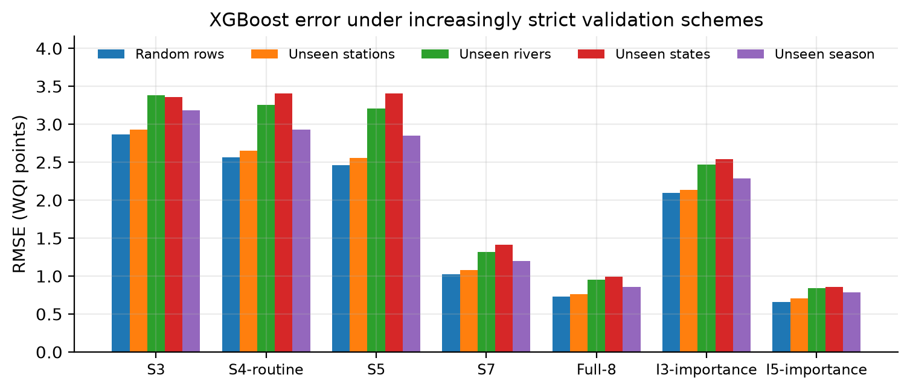
</p>

> **Figure 22.** XGBoost RMSE under increasingly strict validation. Holding out whole rivers or states costs <code>S3</code> about 0.4–0.5 WQI points.

Three observations follow.

1.  **Random splits are only mildly optimistic here.** For `S3`, RMSE is 2.87 with random rows and 2.93 with unseen stations. The relationship being learned is mostly physico-chemical rather than station-specific, so station memorisation buys little. This is a property of this target, not a licence to use random splits in general.

2.  **Transfer to unseen rivers and states costs 15%.** `S3` RMSE rises from 2.93 to 3.35–3.38, and category accuracy falls from 90.6% to 89.2–89.6%. Even with the whole river, or whole states, held out, R² stays above 0.94.

3.  **Seasonal transfer is intermediate.** Training without the monsoon (or any other season) and predicting it gives R² = 0.949 for `S3`. Because the full panel exists only for 2020, this is the strongest temporal test the data permit.

Station density matters little (Table 10). Stations with only 1–3 visits are predicted about as well as stations with 10–12, which is encouraging for sparsely monitored sites.

**Table 10.** Mean absolute error (XGBoost, unseen stations) by number of labelled visits at the station.

| Visits per station |  Rows | `S3` | `S5` | `S7` | `Full-8` | `I3` |
|:-------------------|------:|-----:|-----:|-----:|---------:|-----:|
| 1–3                |   177 | 2.40 | 2.24 | 0.97 |     0.74 | 1.81 |
| 4–6                |   580 | 2.50 | 2.53 | 0.82 |     0.65 | 1.59 |
| 7–9                | 1,148 | 2.41 | 2.17 | 0.70 |     0.57 | 1.58 |
| 10–12              | 2,126 | 2.69 | 2.08 | 0.71 |     0.49 | 1.50 |
| 13+                |   830 | 1.69 | 0.91 | 0.55 |     0.47 | 1.75 |

### 6.5 How little data is enough? (RQ3)

Figure 23 and Figure 24 show RMSE on the fixed unseen test stations as the training set shrinks from about 474 stations (3,889 visits) to about 9 stations (75 visits). Each point averages 5 folds × 3 random station draws. Fold-averaged R² values for key settings are in Table 11, and full RMSE tables in Appendix B.

<p align="center">
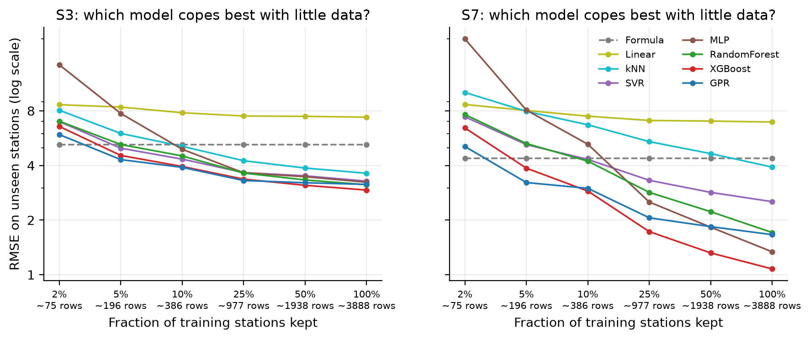
</p>

> **Figure 23.** Data scarcity by model: RMSE on unseen stations (log scale) against the fraction of training stations kept, for <code>S3</code> and <code>S7</code>. Dashed grey: the renormalised formula, which needs no training data.

<p align="center">
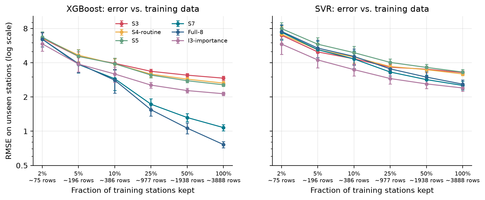
</p>

> **Figure 24.** Data scarcity by subset for XGBoost and SVR (error bars: s.d. over folds and repeats). With little data all subsets perform alike; the value of extra parameters is only realised with enough training stations.

**Table 11.** Fold-averaged R² on unseen stations versus training-set size (mean number of training stations / visits).

|        |         |            |           |           |           |             |             |
|:-------|:--------|-----------:|----------:|----------:|----------:|------------:|------------:|
|        |         |         2% |        5% |       10% |       25% |         50% |        100% |
| Subset | Model   |     9 / 75 |  24 / 196 |  47 / 387 | 118 / 977 | 237 / 1,939 | 474 / 3,889 |
| `S3`   | Formula |  **0.860** |     0.860 |     0.860 |     0.860 |       0.860 |       0.860 |
|        | GPR     |      0.810 | **0.902** | **0.921** | **0.944** |       0.947 |       0.949 |
|        | XGBoost |      0.775 |     0.894 |     0.919 |     0.942 |   **0.950** |   **0.956** |
|        | MLP     | $`-0.619`$ |     0.644 |     0.873 |     0.932 |       0.938 |       0.947 |
| `I3`   | Formula |  **0.873** |     0.873 |     0.873 |     0.873 |       0.873 |       0.873 |
|        | GPR     |      0.860 |     0.918 |     0.941 |     0.960 |       0.967 |       0.969 |
|        | XGBoost |      0.821 | **0.922** | **0.947** | **0.967** |   **0.973** |   **0.977** |
| `S7`   | Formula |  **0.902** |     0.902 |     0.902 |     0.902 |       0.902 |       0.902 |
|        | GPR     |      0.860 | **0.944** |     0.952 |     0.977 |       0.982 |       0.985 |
|        | XGBoost |      0.786 |     0.923 | **0.956** | **0.985** |   **0.991** |   **0.994** |

**There is a minimum viable training set.** With only about 9 training stations (75 visits), *no* learned model beats the renormalised formula for `S3`: formula 0.860, best model (GPR) 0.810. The crossover lies between 9 and 24 stations. From about 24 stations (roughly 200 visits) onwards GPR and XGBoost beat the formula for every subset, and their advantage keeps growing. For `S3` the curve flattens after about 118 stations (25%). Doubling the training set beyond that buys only 0.01 in R².

**Which model to use depends on how much data there is.**

- **Very scarce (fewer than about 50 stations):** GPR is the best or joint-best learner. Its smooth prior and explicit noise model regularise well, and it degrades most gracefully. At 2% it retains category accuracy of 84.0% on `S3` and 91.1% on `Full-8` (Figure 25).

- **Moderate to rich data:** XGBoost takes over and keeps improving, especially for the larger subsets, where it has more interactions to learn.

- **Neural networks need data:** the MLP is the worst model at 2% (R² $`<0`$, i.e. worse than predicting the mean) but competitive at 100%. As anticipated in the methodology, this is an informative negative result for the data-scarce use case.

**Extra parameters only pay off with enough data.** At 2–5% all subsets give similar RMSE (Figure 24). `S7` and `Full-8` separate from `S3` only once about 50 or more training stations are available. The reason is that learning the five-dimensional shape of the extra sub-indices needs more examples. A sparsely monitored region therefore gains more from *more stations* than from *more parameters*, until about 50–100 stations.

<p align="center">
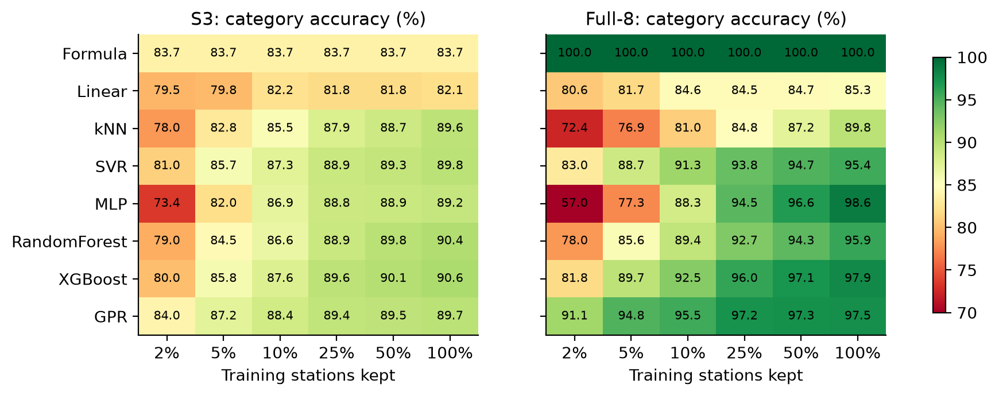
</p>

> **Figure 25.** Category accuracy (%) on unseen stations by model and training size, for <code>S3</code> (left) and <code>Full-8</code> (right).

> **Finding 3**
>
> A three-parameter model needs data from about **25 or more stations** (roughly 200 visits) to beat simply re-weighting the formula, and about **120 stations** to come within 0.01 R² of its full-data accuracy. Below that, use the formula or a GPR. With full training data, use XGBoost.

### 6.6 Can the model say when not to trust it? (RQ4)

Table 12 and Figure 26 compare four ways of building 90% prediction intervals on unseen stations.

**Table 12.** Nominal 90% intervals on unseen stations: empirical coverage / mean width (WQI points). “One cat.” is the share of visits whose whole interval lies within one category, i.e. the category can be stated confidently.

| Subset | GPR | Split-conformal | Quantile GBM (raw) | CQR | One cat. (conf.) |
|:---|:--:|:--:|:--:|:--:|---:|
| `S3` | 93.1 / 10.2 | 90.3 / 9.5 | 76.9 / 7.2 | 90.9 / 9.0 | 62% |
| `S4-routine` | 91.7 / 9.6 | 91.6 / 9.1 | 74.7 / 6.6 | 91.3 / 8.5 | 63% |
| `S5` | 90.0 / 9.4 | 90.9 / 8.7 | 74.3 / 6.5 | 91.6 / 8.6 | 65% |
| `S7` | 91.1 / 3.6 | 91.4 / 3.2 | 74.1 / 4.1 | 91.7 / 5.4 | 87% |
| `I3-importance` | 89.1 / 7.3 | 90.8 / 7.0 | 77.2 / 5.3 | 91.5 / 7.5 | 72% |
| `Full-8` | 86.0 / 2.2 | 92.3 / 2.5 | 73.1 / 4.4 | 91.5 / 5.5 | 90% |

<p align="center">
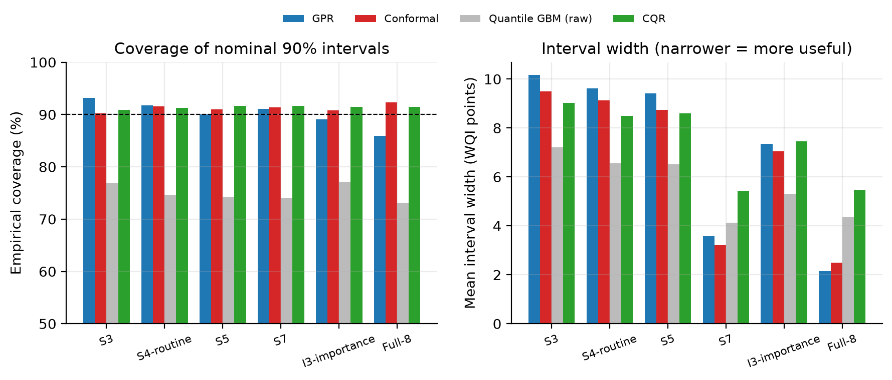
</p>

> **Figure 26.** Coverage (left; dashed line = nominal 90%) and mean width (right) of the four interval methods.

**Split-conformal intervals are the method of choice.** Built around the XGBoost point prediction, with the half-width taken from inner station-grouped CV residuals, they achieve 90.3–92.3% coverage for every subset. Their calibration curve lies on the diagonal at every level from 50% to 95% (Figure 27). Their half-widths are ±4.75 points for `S3`, ±3.5 for `I3` and ±1.6 for `S7`. Because the guarantee is distribution-free, it does not depend on the model being correct, which is exactly the property needed at a data-scarce site. They are simple, need only one model, and are the narrowest valid intervals for the larger subsets.

**Raw quantile regression under-covers.** Gradient-boosted 5%/95% quantile models reach only 73–77% coverage at new stations, because quantiles learned on the training stations are too narrow for unseen ones. Conformalising them (CQR) restores 91–92% coverage with intervals whose width adapts to the input. For the three- to five-parameter subsets CQR is slightly narrower than plain conformal (by 0.1–0.6 points). For `S7` and `Full-8`, however, it is much wider (5.4 vs. 3.2 and 2.5), because the quantile models are less accurate than the XGBoost point model.

**GPR intervals are well-sized at 90% but miscalibrated elsewhere.** For `S3` the GPR curve is S-shaped (Figure 27): 38% coverage at nominal 50%, but 93% at nominal 90%. The residuals are heavier-tailed than Gaussian. For `Full-8`, GPR under-covers (86%), because its subset-of-data fit underestimates the noise. GPR intervals are therefore usable as a rough guide but should be conformalised before reporting.

<p align="center">
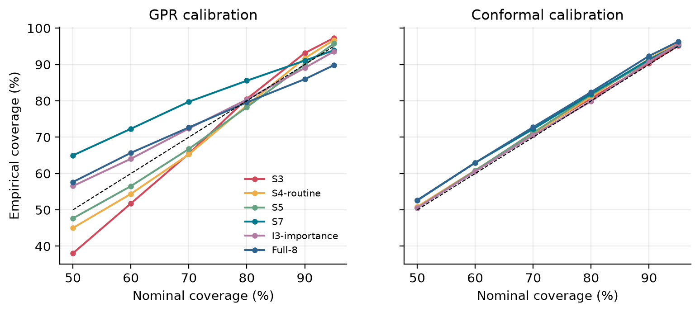
</p>

> **Figure 27.** Calibration of GPR (left) and split-conformal (right) intervals across nominal levels. The dashed line is perfect calibration.

**Usefulness, not just validity.** With `S3`, 62% of unseen-station visits get an interval lying entirely inside one category. For the remaining 38% the honest report is “between Good and Poor” or similar. `I3` raises the share of confidently categorised visits to 72% and `S7` to 87%. Coverage holds within every category except “Very Poor” under `S7` (88%). It holds both when turbidity is above its standard (93% for `S3`) and when it is below it (88%), even though `S3` cannot see turbidity. Figure 28 shows two unseen stations through 2020, including the monsoon minimum at the Tungabhadra (July) that the `S3` model tracks.

<p align="center">
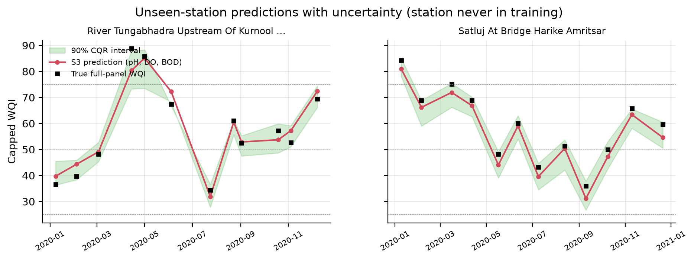
</p>

> **Figure 28.** Two stations that were never in training: true full-panel WQI (squares), <code>S3</code> prediction (red) and 90% CQR interval (green) through 2020.

### 6.7 Robustness to missing readings and measurement noise

Figure 29 summarises three robustness experiments on unseen stations.

<p align="center">
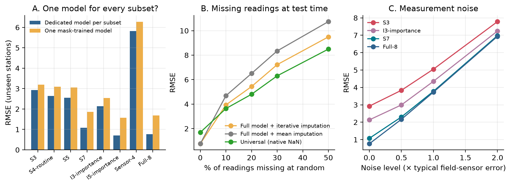
</p>

> **Figure 29.** (A) One mask-trained XGBoost serving every subset versus a dedicated model per subset. (B) Readings missing completely at random at test time. (C) Gaussian measurement noise on test inputs, in multiples of typical field error (<span class="math inline"><em>σ</em><sub>pH</sub> = 0.1</span>, <span class="math inline"><em>σ</em><sub>DO</sub> = 0.3</span> mg/L, BOD 15%, turbidity 10%, nitrate 15%, EC 5%, coliforms 50%).

**(A) One model for all subsets is convenient but costs accuracy.** A single XGBoost trained on randomly masked copies of the data can accept any subset, with missing values as NaN. It is only slightly worse than dedicated models for the small subsets (`S3`: RMSE 3.20 vs 2.93; category accuracy 89.9% vs 90.6%). For the large ones it is clearly worse (`Full-8`: 1.69 vs 0.76). Training separate models is cheap, so the recommended deployment is a *bank* of dedicated subset models with routing on the observed parameters. All 255 have already been fitted (Section 6.2).

**(B) Missing readings.** When 10–50% of the readings in a full-panel visit go missing at random, the mask-trained model with native NaN handling degrades most gracefully. At 30% missing its RMSE is 6.31, against 7.22 with iterative imputation and 8.34 with mean imputation. Even 10% random missingness (RMSE 3.6–4.7) is worse than simply using the `S3` model (2.93). The reason is that random missingness sometimes removes pH or BOD, which no imputer can recover. Imputing a missing pH or BOD is worse than routing to a model that never needed it.

**(C) Measurement precision matters more than parameter count.** At typical field-instrument noise (scale 1), RMSE rises to 5.05 for `S3`, 4.35 for `I3` and 3.73 for `Full-8`. A noisy full panel is therefore *worse* than a clean three-parameter panel (2.93). Applying noise to one parameter at a time (Table 13) shows that almost all of this comes from **pH**. An error of only $`\sigma=0.1`$ pH units raises the `Full-8` RMSE from 0.76 to 3.13, because the pH sub-index changes by 6.7 points per 0.1 pH above 7 and carries 40% of the weight. BOD at 15% relative error is the second-largest source. Noise on EC and on the coliforms, even at 50%, has no effect.

**Table 13.** RMSE when typical field noise is applied to one parameter at a time (XGBoost, unseen stations; clean RMSE in the first column).

| Subset   | clean |   pH |  BOD |   DO | Turb. | Nitrate |   EC | Fecal | Total |
|:---------|------:|-----:|-----:|-----:|------:|--------:|-----:|------:|------:|
| `S3`     |  2.93 | 4.43 | 3.68 | 3.03 |     – |       – |    – |     – |     – |
| `I3`     |  2.14 | 3.75 | 3.13 |    – |  2.17 |       – |    – |     – |     – |
| `S7`     |  1.08 | 3.25 | 2.29 | 1.19 |  1.10 |       – | 1.08 |  1.09 |  1.08 |
| `Full-8` |  0.76 | 3.13 | 2.11 | 0.90 |  0.80 |    0.78 | 0.76 |  0.76 |  0.77 |

> **Finding 4**
>
> For the CPCB index, a pH reading accurate to ±0.05 is worth more than five extra parameters. A monitoring programme that adopts a reduced panel should invest the savings in pH calibration (two-point buffer calibration before each run) and in BOD quality control.

### 6.8 Sensitivity to the definition of the index

**(A) Standard values.** We measure how the target changes when each standard $`S_i`$ is halved or doubled (all weights are recomputed). The index is highly sensitive to the BOD standard: halving it to 1.5 mg/L changes the category of 47% of visits. It is moderately sensitive to the turbidity and nitrate standards (6–12% category changes), and insensitive to the coliform and EC standards (≤0.3%). **Sweeping the EC standard from 250 to 4,000 µS/cm changes the index by at most 0.26 points and the category of at most 0.35% of visits.** This closes the project’s open concern that the EC standard was the least well-sourced value: under CPCB weighting, its value barely matters. The `S3` model remains accurate under every variant (R² = 0.90–0.98). It is weakest when the turbidity standard is halved, which doubles the weight of the parameter `S3` cannot see.

<p align="center">
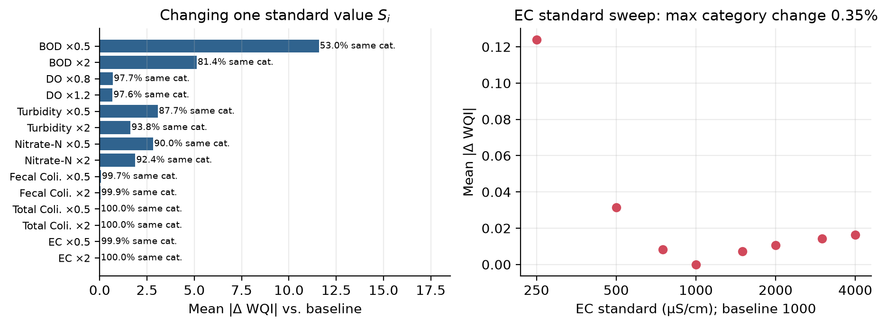
</p>

> **Figure 30.** Left: mean absolute change of the index, and share of visits keeping their category, when one standard is halved or doubled. Right: EC standard sweep.

**(B) Equal weights reverse the importance ranking.** If every capped sub-index is given equal weight $`1/8`$, the variance share of the index moves to the parameters the CPCB weights ignore (Figure 31): fecal coliform 27%, total coliform 25%, turbidity 18% and BOD 15%, with pH only 4%. The two indices are only moderately rank-correlated ($`\rho_S=0.74`$). Under this target `S3` collapses to R² = 0.62 (rank 47 of 56), and `I3` to 0.80. The best three-parameter subset becomes turbidity, EC and total coliform (0.91). Only `S7` is near the top under *both* definitions (0.994 and 0.990), because it contains BOD, turbidity and both coliforms.

<p align="center">
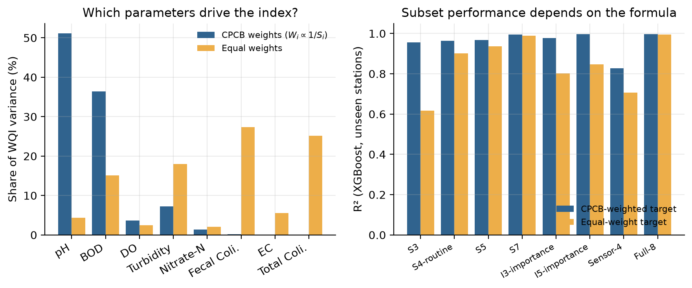
</p>

> **Figure 31.** Left: variance share per parameter under CPCB and equal weights. Right: station-held-out R<span class="math inline"><sup>2</sup></span> of the named subsets for the two targets.

**(C) Uncapped index.** Predicting the uncapped index (on a $`\log_{10}`$ scale, five categories including “Unsuitable”) is a different problem. Its extreme values are driven by turbidity spikes and occasional BOD spikes. `S3` reaches only R² = 0.37 and recalls 54% of Unsuitable visits. Adding turbidity changes everything: `I3` reaches 0.98 with 94% Unsuitable recall, and `S7` 0.993 with 97% (Table 14).

**Table 14.** Predicting the uncapped index (XGBoost on $`\log_{10}`$ WQI, unseen stations).

| Subset | R² ($`\log`$) | 5-class acc. | Unsuitable recall | Median rel. error |
|:---|---:|---:|---:|---:|
| `S3` | 0.374 | 45.6% | 53.5% | 27.4% |
| `S4-routine` | 0.631 | 62.9% | 72.6% | 16.0% |
| `S5` | 0.698 | 65.2% | 73.1% | 14.6% |
| `I3-importance` | 0.980 | 90.5% | 94.3% | 3.7% |
| `Sensor-4` | 0.925 | 77.8% | 87.3% | 8.1% |
| `S7` | 0.993 | 95.3% | 97.4% | 1.7% |
| `Full-8` | 0.994 | 96.1% | 97.6% | 1.6% |

> **Finding 5**
>
> *Which* reduced panel is adequate depends on the index definition. pH + BOD (+DO) suffices for the capped CPCB index. Detecting extreme events (the uncapped index) requires turbidity, and an index that gives bacteria real weight requires the coliforms. `S7` is the only subset that is robust across all three definitions.

### 6.9 Deployment: reconstructing WQI where it was never computed

**Scope.** 20,132 river visits report pH, DO and BOD but not the full panel: 5,337 in 2018, 5,705 in 2019, 2,240 in 2020 and 6,850 in 2021. They come from 819 stations on 70 rivers. **255 of these stations never had a single full-panel visit**, so they have never had a WQI. 16,686 of the visits also report fecal coliform and can use `S4-routine`.

**Covariate shift.** The deployment visits are distinguishable from the labelled ones: an adversarial classifier on (pH, DO, BOD) reaches AUC 0.77. The shift is mostly in BOD (KS $`=0.25`$–$`0.31`$; median 2.2–2.5 vs 1.7 mg/L), and pH, DO and fecal coliform shift only slightly (KS $`\le 0.17`$) (Figure 32). Inspecting the raw files shows the cause. **In 2018, 2019 and 2021 no river visit reports a BOD value at or below 1 mg/L**, against 22% of visits in 2020, and 26–28% of biological rows in those years have a blank BOD (4% in 2020). The most likely explanation is that below-detection-limit BOD values were left blank in those years. The deployment set is therefore missing its cleanest visits. Fewer than 2% of deployment values fall outside the 0.5–99.5% range of the training data, so the model is interpolating, not extrapolating.

<p align="center">
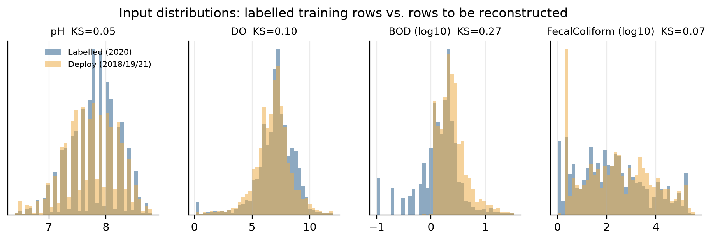
</p>

> **Figure 32.** Inputs of labelled (2020) versus deployment (2018/2019/2021) visits. Note the absence of BOD <span class="math inline">≤</span> 1 mg/L (<span class="math inline">log<sub>10</sub> ≤ 0</span>) in the deployment years.

**Expected error under the shift.** The station-CV errors are re-weighted by the density ratio $`p(\text{deploy}\mid x)/p(\text{labelled}\mid x)`$ from the adversarial classifier (effective sample size 2,107). This estimates the expected error on the deployment distribution: `S3` RMSE **3.01** (unweighted 2.93), category accuracy 90.0% (90.6%), and 90% conformal-interval coverage 88.3% (90.0%). For `S4-routine` the figures are 2.75, 91.3% and 89.1%. The shift therefore costs little accuracy. Restricted to labelled visits with BOD $`>1`$, the `S3` error is unchanged (RMSE 2.89).

**Results.** Figure 33 shows the reconstructed index by year. Mean predicted WQI is 63.0 (2018), 62.3 (2019), 54.7 (2020, unlabelled visits) and 60.9 (2021), against a true 2020 mean of 56.1. The apparent “2020 was cleaner” effect is almost entirely the BOD reporting floor. Restricted to BOD $`>1`$ mg/L, the true 2020 mean is 60.3 and the predicted 2020 mean 59.4, in line with the other years. Year-to-year comparisons must therefore condition on BOD $`>1`$, or treat the blanks as left-censored values, before they are interpreted as trends.

<p align="center">
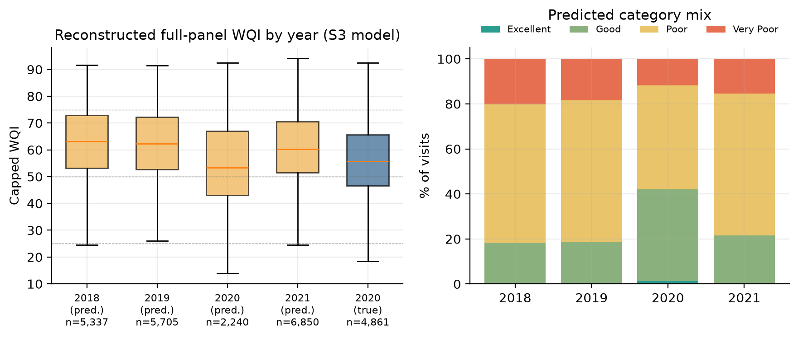
</p>

> **Figure 33.** Reconstructed full-panel WQI (<code>S3</code> model) for visits without a full panel, by year, against the true 2020 labelled values. Right: predicted category mix.

The `S3` and `S4-routine` reconstructions agree closely (correlation 0.994, mean absolute difference 1.2 points). The station ranking is persistent across years: the correlation between a station’s true 2020 mean and its reconstructed mean in another year is 0.60 (2018), 0.71 (2019), 0.73 (2021) and 0.80 (2020, other visits). The river-level reconstruction (Figure 34a) is consistent with known conditions. The Gomti and Bhima are worst in every year, and the Brahmani, Narmada and Mahanadi are consistently in the better half, as in the 2020 ground truth. The renormalised formula would have reported these visits 3.5 points worse on average than the model. Figure 34b maps the reconstructed index, including the 255 stations that gain a WQI for the first time.

<p align="center">
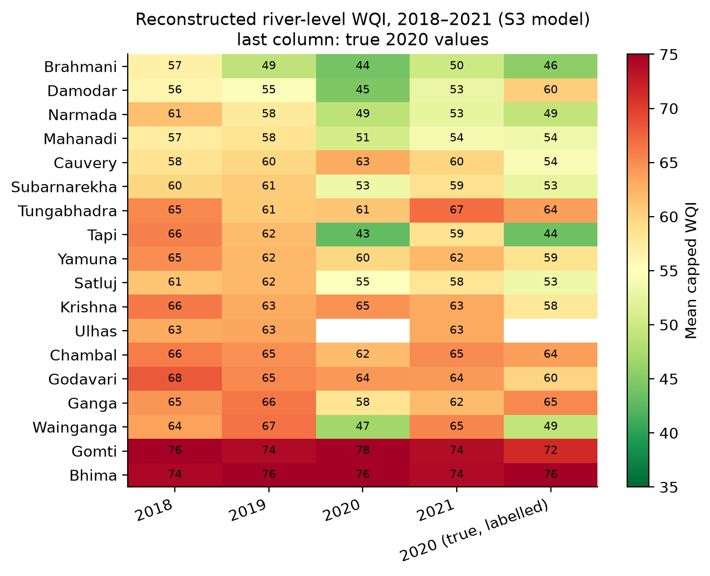
</p>

> **Figure 34b.** River <span class="math inline">×</span> year (18 largest rivers).
<p align="center">
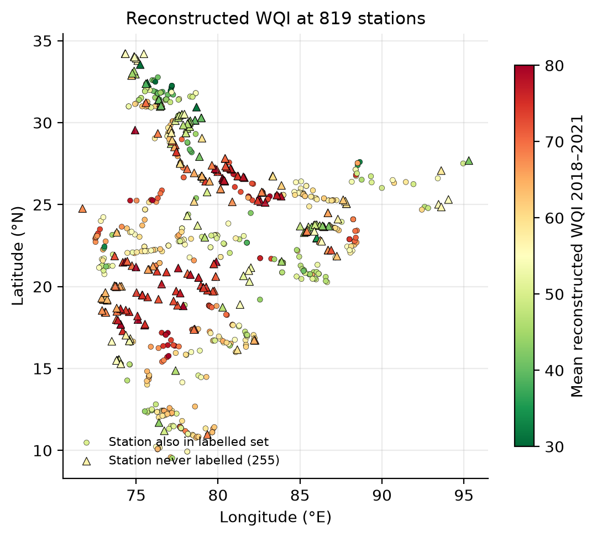
</p>

> **Figure 34b.** Station means, 2018–2021.
<figcaption>Reconstructed WQI. In (b), triangles mark stations that never had a full-panel WQI.</figcaption>
</figure>

## 7. Discussion

### 7.1 Answer to the research question

> **Can reduced-parameter monitoring provide reliable WQI prediction for data-scarce river systems?**
>
> **Yes, for the CPCB index, with three parameters, provided the right three are measured precisely and the model has been trained on at least a few dozen stations.**
>
> At river stations the model has never seen, a model using only pH, DO and BOD reproduces the full eight-parameter index with R² = 0.957, RMSE 2.9 points (on a 0–100 scale with s.d. 14.1) and 90.6% category accuracy. No visit is ever misplaced by more than one category. It holds up on unseen rivers (R² = 0.94), unseen states (0.94) and unseen seasons (0.95), and it comes with conformal intervals that keep their nominal 90% coverage. Swapping DO for turbidity, or adding free location and month information, raises this to R² ≈ 0.98. Adding turbidity to `S3` gives 0.994, practically the full index.

The qualifications matter as much as the headline.

1.  **“The right three”.** Of the 56 possible three-parameter panels, the median achieves only R² = 0.53. The pre-registered `S5` adds two parameters that contribute nothing. Parameter choice must follow the index’s actual structure, which the analytic variance decomposition and the model-based importances both reveal and agree on.

2.  **“For the CPCB index”.** The answer is formula-specific. Under equal weights the same `S3` explains only 62% of the variance, and for the uncapped index 37%. A reduced panel inherits the priorities of the index it imitates.

3.  **“Measured precisely”.** pH noise of ±0.1 costs more accuracy than dropping five parameters.

4.  **“A few dozen stations”.** With fewer than about 25 training stations, no learned model beats re-weighting the formula. The models only pay off from there on.

5.  **BOD is not a sensor.** The best three-parameter panels all contain BOD, a five-day laboratory test. A fully real-time, probe-only panel (`Sensor-4`: pH, DO, EC, turbidity) reaches only R² = 0.83 (category accuracy 82%). That is a useful screening tool, not a substitute for the index.

### 7.2 Recommended monitoring kit

Table 15 turns the results into tiers. Each tier lists its incremental cost and the accuracy expected at an *unseen* station, with a 90% conformal half-width.

**Table 15.** Recommended tiers (XGBoost, unseen stations). “Half-width” is the 90% split-conformal interval half-width in WQI points, from the pooled out-of-fold residuals. Tier 0 uses `S4-routine+context`, Tier 1 `I4-importance` and Tier 2 `I5-importance`.

| Tier | Parameters (added cost) | R² | RMSE | Cat. acc. | Half-width |
|:---|:---|---:|---:|---:|---:|
| Routine | pH, DO, BOD, fecal coliform + lat/lon/month (nothing new: what stations already report) | 0.977 | 2.12 | 93.9% | 3.6 |
| \+ turbidity probe | pH, DO, BOD, turbidity (one cheap, instant probe) | 0.994 | 1.13 | 96.8% | 1.6 |
| \+ nitrate kit | pH, DO, BOD, turbidity, nitrate-N (field kit) | 0.998 | 0.70 | 97.7% | 1.1 |
| Robust / public health | `S7`: pH, DO, BOD, fecal & total coliform, EC, turbidity | 0.994 | 1.08 | 97.0% | 1.5 |
| Screening only | `Sensor-4`: pH, DO, EC, turbidity (all probes, no lab) | 0.828 | 5.82 | 82.4% | 9.8 |

These tiers come with operating rules:

- **Calibrate pH to ±0.05** and quality-control BOD. These two measurements carry 87.5% of the index variance.

- **Use a bank of dedicated models** routed on whichever parameters were actually measured, rather than imputing missing pH or BOD.

- **Match the model to the data volume.** Use the renormalised formula below about 25 training stations, GPR up to about 50–100, and XGBoost beyond that.

- **Always publish the conformal interval** with the estimate. Flag visits whose interval straddles a category boundary (roughly 35–40% of visits for `S3`) as “category uncertain”.

- **Report fecal coliform exceedance separately** (next subsection).

### 7.3 Why learning beats re-weighting the formula

When a parameter is missing, re-weighting the formula over the observed parameters implicitly assumes that the missing sub-indices equal the weighted average of the observed ones. In river water this is systematically wrong. Turbidity’s capped sub-index averages 67, while the observed `S3` sub-indices average about 60, and turbidity’s sub-index varies with season and region rather than with pH. A learned model instead estimates $`\mathbb{E}[\text{missing contribution}\mid x_S]`$, which uses the correlations between parameters (BOD with turbidity and coliforms, monsoon with turbidity, region with all of them). This is why it gains most where the formula fails worst. Examples are `Sensor-4`, where R² rises from 0.39 to 0.83, and the context-augmented subsets, where month and location carry information that no formula can use.

### 7.4 The coliform blind spot

Under $`W_i\propto 1/S_i`$, fecal coliform (standard 500 MPN/100 mL) receives a weight of 0.0016, against 0.40 for pH (“standard” 2 pH units). As a result fecal coliform exceeds the CPCB bathing standard on 33.7% of visits yet explains 0.2% of the index. Two practical consequences follow. First, the success of `S3` is partly an artefact of this blind spot: the reduced panel does not need coliforms because the index does not use them. Second, any agency using either the full or the reduced CPCB index to communicate bathing safety should publish the fecal coliform exceedance *alongside* it. Alternatively it should adopt a weighting that gives pathogens real influence, for which `S7` is the reduced panel that holds up (Section 6.8).

### 7.5 Comparison with the original project plan

Several planned elements changed in response to the real data:

- **Hypothesised sensor-only subsets** (pH, DO, temperature, conductivity, turbidity) were infeasible. Temperature is never recorded in this feed, and probe-only panels lack the BOD signal the index depends on.

- **The pre-registered subsets** were kept and evaluated. `S3` proved an excellent choice, `S5` a poor one.

- **The temporal split** was replaced by a held-out-season scheme because labels exist for 2020 only.

- **Cross-country transfer** (USGS/WQP) and the **interactive demo app** were not attempted. Neither is needed to answer the research question, and both remain natural extensions.

### 7.6 Limitations and threats to validity

- **One labelled year.** All ground truth is from 2020. Seasonal transfer was tested, but inter-annual transfer could not be validated directly. The deployment to 2018, 2019 and 2021 rests on the shift-corrected error estimate and on the plausibility checks in Section 6.9, not on held-out truth.

- **BOD reporting floor.** Outside 2020, low BOD values appear to be left blank. This is a selection effect on which visits can be reconstructed, not a model error, but it biases naive year-to-year comparisons upward. A censored-data treatment (e.g. Tobit models or substitution at half the detection limit) would let those visits be included.

- **Ground-truth definition.** Every accuracy number is relative to one index definition with documented but partly secondary standards. Section 6.8 shows how much this matters.

- **River identification** relies on matching about 95 river names. Stations on rivers missing from the list are excluded, so the study covers major and medium rivers better than small ones. Those small rivers are precisely the most data-scarce systems.

- **Spatial dependence.** Holding out stations does not remove correlation between neighbouring stations on the same river. The unseen-river and unseen-state schemes bound this effect (RMSE +15%).

- **Fixed hyper-parameters** were used for fairness across subsets. Tuning could improve every model slightly but would not change the rankings, which are separated by much larger margins.

- **GPR approximation.** GPR was fitted to at most 1,500 rows. This handicaps it at full data size but not in the scarce regime where it is recommended.

- **Data issues found but not fixed.** A misplaced 92-row CWC file, and about 3,000 rows in 2020 with colour descriptors (“Clear”, “Light Brown”) in the BOD column, point to column misalignment in some source files. Neither affects the labelled set, because those rows lack a numeric BOD.

## 8. Conclusion and Future Work

Using 32,968 real CPCB river monitoring visits, this study shows that the full eight-parameter water quality index is available for only 15% of visits, and only for a single year. It also shows that this gap can largely be closed with reduced-parameter models. The capped CPCB index is dominated by pH and BOD. A model trained on pH, DO and BOD from about 25 or more stations reproduces it at new stations with R² = 0.96, category accuracy 91% and calibrated intervals of about ±4.7 points. Adding a turbidity probe brings it to R² = 0.99. Machine learning clearly outperforms re-computing the index from the available parameters, except when training data come from fewer than about 25 stations. Applied to the visits that never had a full panel, the model gives the first full-panel WQI estimates for 20,132 visits and 255 stations.

The study also qualifies the premise. The parameters that matter are dictated by the index’s weighting, and the CPCB weighting is effectively blind to bacterial contamination. Measurement precision, above all for pH, matters more than the number of parameters. Year-to-year comparisons in the CPCB record are confounded by a BOD reporting floor.

**Future work.**

1.  Add 2022 onward data, if more full-panel years become available, to test inter-annual transfer directly.

2.  Treat below-detection-limit BOD as left-censored instead of missing.

3.  Repeat the analysis for the NSF and CCME indices and for a pathogen-weighted index.

4.  Use the CPCB real-time stations (pH, DO, conductivity, turbidity, temperature every 15 minutes) to test sensor-only panels at high frequency.

5.  Replace the turbidity probe with satellite turbidity proxies (e.g. Sentinel-2 reflectance) for a zero-hardware Tier 1.

6.  Formulate parameter selection as a cost-constrained optimisation using real per-test costs.

7.  Package the model bank with conformal intervals as a small web tool for monitoring staff.

## References

1.  U. Ahmed, R. Mumtaz, H. Anwar, A. A. Shah, R. Irfan and J. García-Nieto. Efficient water quality prediction using supervised machine learning. *Water*, 11(11):2210, 2019.

2.  R. F. Barber, E. J. Candès, A. Ramdas and R. J. Tibshirani. Predictive inference with the jackknife+. *The Annals of Statistics*, 49(1):486–507, 2021.

3.  L. Breiman. Random forests. *Machine Learning*, 45(1):5–32, 2001.

4.  R. M. Brown, N. I. McClelland, R. A. Deininger and R. G. Tozer. A water quality index—do we dare? *Water and Sewage Works*, 117(10):339–343, 1970.

5.  Canadian Council of Ministers of the Environment. *Canadian Water Quality Guidelines for the Protection of Aquatic Life: CCME Water Quality Index 1.0, Technical Report*. Winnipeg, 2001.

6.  T. Chen and C. Guestrin. XGBoost: A scalable tree boosting system. In *Proceedings of the 22nd ACM SIGKDD International Conference on Knowledge Discovery and Data Mining*, pages 785–794, 2016.

7.  Central Pollution Control Board, Government of India. Surface Water Quality (Manual) datasets, National Water Quality Monitoring Programme. National Water Data Portal, <https://nwdp.nwic.gov.in>. Accessed September 2026.

8.  H. V. Gupta, H. Kling, K. K. Yilmaz and G. F. Martinez. Decomposition of the mean squared error and NSE performance criteria: implications for improving hydrological modelling. *Journal of Hydrology*, 377(1–2):80–91, 2009.

9.  R. K. Horton. An index number system for rating water quality. *Journal of the Water Pollution Control Federation*, 37(3):300–306, 1965.

10. A. Kraskov, H. Stögbauer and P. Grassberger. Estimating mutual information. *Physical Review E*, 69(6):066138, 2004.

11. S. M. Lundberg and S.-I. Lee. A unified approach to interpreting model predictions. In *Advances in Neural Information Processing Systems 30*, 2017.

12. J. E. Nash and J. V. Sutcliffe. River flow forecasting through conceptual models part I—a discussion of principles. *Journal of Hydrology*, 10(3):282–290, 1970.

13. F. Pedregosa et al. Scikit-learn: Machine learning in Python. *Journal of Machine Learning Research*, 12:2825–2830, 2011.

14. C. E. Rasmussen and C. K. I. Williams. *Gaussian Processes for Machine Learning*. MIT Press, 2006.

15. D. R. Roberts, V. Bahn, S. Ciuti, M. S. Boyce, J. Elith, G. Guillera-Arroita, S. Hauenstein, J. J. Lahoz-Monfort, B. Schröder, W. Thuiller, D. I. Warton, B. A. Wintle, F. Hartig and C. F. Dormann. Cross-validation strategies for data with temporal, spatial, hierarchical, or phylogenetic structure. *Ecography*, 40(8):913–929, 2017.

16. Y. Romano, E. Patterson and E. J. Candès. Conformalized quantile regression. In *Advances in Neural Information Processing Systems 32*, 2019.

17. S. Tyagi, B. Sharma, P. Singh and R. Dobhal. Water quality assessment in terms of water quality index. *American Journal of Water Resources*, 1(3):34–38, 2013.

18. M. G. Uddin, S. Nash and A. I. Olbert. A review of water quality index models and their use for assessing surface water quality. *Ecological Indicators*, 122:107218, 2021.

19. V. Vovk, A. Gammerman and G. Shafer. *Algorithmic Learning in a Random World*. Springer, 2005.

## Appendix A. Model hyper-parameters

All values are fixed *a priori* and shared by every subset, training size and validation scheme (`scripts/common.py`, `make_model`).

| Model | Settings |
|:---|:---|
| Pre-processing | $`\log(1+x)`$ on BOD, fecal coliform, total coliform, turbidity, nitrate-N and EC; then standardisation (Linear, *k*NN, SVR, MLP, GPR only) |
| Formula | Eq. (4) over the available parameters, weights $`K'/S_i`$ renormalised to sum to 1, $`q_i`$ capped at 100 |
| Linear | `LinearRegression()` |
| *k*NN | `n_neighbors=10, weights="distance"` |
| SVR | `kernel="rbf", C=30, epsilon=0.5, gamma="scale"` |
| MLP | `hidden_layer_sizes=(64,32), alpha=1e-3, learning_rate_init=3e-3, max_iter=3000, early_stopping=True, n_iter_no_change=30` |
| Random forest | `n_estimators=400, min_samples_leaf=2, max_features=1.0` |
| XGBoost | `n_estimators=600, learning_rate=0.03, max_depth=5, subsample=0.8, colsample_bytree=0.9, min_child_weight=3, reg_lambda=1, tree_method="hist"` |
| GPR | kernel $`C\cdot\text{RBF}_{\text{ARD}}+\text{White}`$, `normalize_y=True`, 1 optimiser restart (0 in the scarcity sweep), at most 1,500 training rows |
| Quantile GBM (CQR) | scikit-learn `HistGradientBoostingRegressor(loss="quantile")` at $`q=0.05`$ and $`0.95`$; `max_iter=400, learning_rate=0.05, max_leaf_nodes=31, min_samples_leaf=20` |
| Universal masked model | XGBoost as above with `n_estimators=900`; training data = original + 6 masked copies, each value dropped with probability 0.5 (at least one kept) |

## Appendix B. Full result tables

All values on unseen stations unless stated; best learned model per row in bold (the Formula column is excluded from the bold because at `Full-8` and `I5` it is (nearly) the target itself).

**Table 16.** RMSE (WQI points) for every model and subset.

| Subset               | Formula | Linear | *k*NN |  SVR |      MLP |   RF |      XGB |  GPR |
|:---------------------|--------:|-------:|--------:|-----:|---------:|-----:|---------:|-----:|
| `S3`                 |    5.21 |   7.40 |    3.62 | 3.28 |     3.23 | 3.13 | **2.93** | 3.15 |
| `S4-routine`         |    5.17 |   7.14 |    3.61 | 3.19 |     3.05 | 2.95 | **2.65** | 3.02 |
| `S5`                 |    5.16 |   7.13 |    3.93 | 3.31 |     3.08 | 2.90 | **2.56** | 3.00 |
| `S7`                 |    4.37 |   6.96 |    3.92 | 2.53 |     1.35 | 1.71 | **1.08** | 1.72 |
| `Full-8`             |    0.00 |   6.93 |    4.30 | 2.60 | **0.76** | 1.62 |     0.76 | 1.78 |
| `I3-importance`      |    4.99 |   7.04 |    2.75 | 2.40 |     2.40 | 2.33 | **2.14** | 2.47 |
| `I4-importance`      |    4.42 |   7.03 |    2.63 | 1.85 |     1.20 | 1.61 | **1.13** | 1.76 |
| `I5-importance`      |    0.08 |   7.03 |    3.19 | 2.01 |     1.14 | 1.50 | **0.70** | 1.76 |
| `Sensor-3`           |   12.91 |  10.12 |    7.87 | 7.81 |     7.77 | 7.68 | **7.42** | 7.84 |
| `Sensor-4`           |   10.99 |   9.52 |    6.40 | 6.31 |     6.29 | 6.10 | **5.82** | 6.41 |
| `S3+context`         |       – |   7.19 |    4.40 | 3.13 |     2.80 | 2.65 | **2.17** | 2.77 |
| `S4-routine+context` |       – |   7.09 |    4.71 | 3.13 |     2.86 | 2.65 | **2.12** | 2.72 |

**Table 17.** MAE (WQI points) for every model and subset.

| Subset               | Formula | Linear | *k*NN |  SVR |      MLP |   RF |      XGB |  GPR |
|:---------------------|--------:|-------:|--------:|-----:|---------:|-----:|---------:|-----:|
| `S3`                 |    4.28 |   4.88 |    2.72 | 2.54 |     2.69 | 2.50 | **2.42** | 2.67 |
| `S4-routine`         |    4.26 |   4.56 |    2.61 | 2.33 |     2.39 | 2.26 | **2.07** | 2.42 |
| `S5`                 |    4.24 |   4.56 |    2.74 | 2.32 |     2.37 | 2.22 | **1.96** | 2.34 |
| `S7`                 |    4.16 |   4.23 |    2.55 | 1.19 |     0.80 | 1.13 | **0.70** | 0.83 |
| `Full-8`             |    0.00 |   4.20 |    2.84 | 1.16 | **0.39** | 1.07 |     0.53 | 0.61 |
| `I3-importance`      |    3.87 |   4.33 |    1.89 | 1.71 |     1.68 | 1.70 | **1.58** | 1.73 |
| `I4-importance`      |    4.21 |   4.27 |    1.55 | 0.94 | **0.69** | 1.04 |     0.74 | 0.85 |
| `I5-importance`      |    0.07 |   4.25 |    1.96 | 0.88 |     0.55 | 0.98 | **0.49** | 0.60 |
| `Sensor-3`           |   10.50 |   7.73 |    6.05 | 6.11 |     6.14 | 5.93 | **5.81** | 6.28 |
| `Sensor-4`           |    9.15 |   7.05 |    4.80 | 4.78 |     4.85 | 4.63 | **4.46** | 4.97 |
| `S3+context`         |       – |   4.61 |    3.10 | 1.96 |     2.02 | 1.98 | **1.58** | 1.89 |
| `S4-routine+context` |       – |   4.54 |    3.31 | 1.93 |     2.05 | 1.97 | **1.55** | 1.85 |

**Table 18.** Category accuracy (fraction) for every model and subset.

| Subset | Formula | Linear | *k*NN | SVR | MLP | RF | XGB | GPR |
|:---|---:|---:|---:|---:|---:|---:|---:|---:|
| `S3` | 0.837 | 0.821 | 0.896 | 0.898 | 0.892 | 0.904 | **0.906** | 0.897 |
| `S4-routine` | 0.838 | 0.827 | 0.901 | 0.905 | 0.904 | 0.911 | **0.918** | 0.906 |
| `S5` | 0.838 | 0.828 | 0.893 | 0.902 | 0.907 | 0.914 | **0.923** | 0.908 |
| `S7` | 0.835 | 0.845 | 0.904 | 0.951 | **0.973** | 0.955 | 0.970 | 0.966 |
| `Full-8` | 1.000 | 0.853 | 0.898 | 0.954 | **0.986** | 0.958 | 0.978 | 0.975 |
| `I3-importance` | 0.855 | 0.841 | 0.928 | 0.935 | 0.938 | 0.937 | **0.940** | 0.934 |
| `I4-importance` | 0.833 | 0.844 | 0.938 | 0.958 | **0.973** | 0.959 | 0.967 | 0.966 |
| `I5-importance` | 0.998 | 0.846 | 0.926 | 0.963 | **0.980** | 0.963 | 0.977 | 0.974 |
| `Sensor-3` | 0.595 | 0.710 | 0.760 | 0.757 | 0.757 | 0.770 | **0.775** | 0.749 |
| `Sensor-4` | 0.649 | 0.734 | 0.809 | 0.808 | 0.808 | 0.813 | **0.824** | 0.797 |
| `S3+context` | – | 0.820 | 0.880 | 0.922 | 0.920 | 0.923 | **0.933** | 0.922 |
| `S4-routine+context` | – | 0.825 | 0.873 | 0.919 | 0.916 | 0.925 | **0.939** | 0.926 |

**Table 19.** R² of every model for `S3` under the five validation schemes.

| Model        | Random | Stations | Rivers | States | Season |
|:-------------|-------:|---------:|-------:|-------:|-------:|
| Formula      |  0.863 |    0.863 |  0.863 |  0.863 |  0.863 |
| Linear       |  0.728 |    0.723 |  0.698 |  0.715 |  0.723 |
| kNN          |  0.939 |    0.934 |  0.918 |  0.922 |  0.924 |
| SVR          |  0.948 |    0.946 |  0.932 |  0.933 |  0.935 |
| MLP          |  0.948 |    0.947 |  0.939 |  0.938 |  0.937 |
| RandomForest |  0.953 |    0.950 |  0.936 |  0.937 |  0.943 |
| XGBoost      |  0.958 |    0.957 |  0.942 |  0.943 |  0.949 |
| GPR          |  0.951 |    0.950 |  0.940 |  0.942 |  0.943 |

**Table 20.** Data-scarcity sweep, `S3`: RMSE by fraction of training stations kept (mean training rows in brackets; mean of 5 folds × 3 repeats).

| Model        | 2% (75) | 5% (196) | 10% (386) | 25% (977) | 50% (1938) | 100% (3888) |
|:-------------|--------:|---------:|----------:|----------:|-----------:|------------:|
| Formula      |    5.20 |     5.20 |      5.20 |      5.20 |       5.20 |        5.20 |
| Linear       |    8.65 |     8.39 |      7.81 |      7.49 |       7.46 |        7.38 |
| kNN          |    8.06 |     6.00 |      5.10 |      4.25 |       3.87 |        3.62 |
| SVR          |    6.98 |     4.98 |      4.33 |      3.65 |       3.51 |        3.28 |
| MLP          |   14.33 |     7.73 |      4.91 |      3.64 |       3.47 |        3.23 |
| RandomForest |    7.01 |     5.22 |      4.51 |      3.63 |       3.33 |        3.13 |
| XGBoost      |    6.56 |     4.54 |      3.95 |      3.36 |       3.11 |        2.93 |
| GPR          |    5.92 |     4.31 |      3.90 |      3.30 |       3.21 |        3.14 |

**Table 21.** Data-scarcity sweep, `S7`: RMSE by fraction of training stations kept (mean training rows in brackets; mean of 5 folds × 3 repeats).

| Model        | 2% (75) | 5% (196) | 10% (386) | 25% (977) | 50% (1938) | 100% (3888) |
|:-------------|--------:|---------:|----------:|----------:|-----------:|------------:|
| Formula      |    4.37 |     4.37 |      4.37 |      4.37 |       4.37 |        4.37 |
| Linear       |    8.67 |     8.04 |      7.48 |      7.08 |       7.03 |        6.94 |
| kNN          |   10.10 |     7.94 |      6.70 |      5.41 |       4.65 |        3.92 |
| SVR          |    7.41 |     5.21 |      4.32 |      3.31 |       2.84 |        2.53 |
| MLP          |   19.90 |     8.07 |      5.24 |      2.51 |       1.83 |        1.34 |
| RandomForest |    7.63 |     5.28 |      4.22 |      2.84 |       2.22 |        1.71 |
| XGBoost      |    6.43 |     3.86 |      2.89 |      1.73 |       1.32 |        1.08 |
| GPR          |    5.09 |     3.22 |      2.99 |      2.06 |       1.84 |        1.66 |

**Table 22.** Data-scarcity sweep, `I3-importance`: RMSE by fraction of training stations kept (mean training rows in brackets; mean of 5 folds × 3 repeats).

| Model        | 2% (75) | 5% (196) | 10% (386) | 25% (977) | 50% (1938) | 100% (3888) |
|:-------------|--------:|---------:|----------:|----------:|-----------:|------------:|
| Formula      |    4.99 |     4.99 |      4.99 |      4.99 |       4.99 |        4.99 |
| Linear       |    8.13 |     7.75 |      7.32 |      7.12 |       7.09 |        7.02 |
| kNN          |    7.74 |     5.64 |      4.56 |      3.66 |       3.13 |        2.74 |
| SVR          |    5.83 |     4.23 |      3.48 |      2.90 |       2.61 |        2.40 |
| MLP          |   13.93 |     7.06 |      4.18 |      2.84 |       2.57 |        2.40 |
| RandomForest |    6.70 |     4.85 |      4.05 |      2.96 |       2.59 |        2.33 |
| XGBoost      |    5.86 |     3.89 |      3.18 |      2.54 |       2.28 |        2.13 |
| GPR          |    5.08 |     3.92 |      3.37 |      2.76 |       2.52 |        2.45 |

**Table 23.** Best subset of each size when the target is the *equal-weight* index.

| *k* | Subset | R² | RMSE | Cat. acc. |
|---:|:---|---:|---:|---:|
| 1 | Total coli. | 0.722 | 8.46 | 81.3% |
| 2 | Fecal coli., EC | 0.841 | 6.41 | 83.1% |
| 3 | Turbidity, EC, Total coli. | 0.914 | 4.70 | 86.0% |
| 4 | BOD, Turbidity, Fecal coli., EC | 0.955 | 3.42 | 90.2% |
| 5 | pH, BOD, Turbidity, EC, Total coli. | 0.979 | 2.33 | 94.0% |
| 6 | pH, BOD, Turbidity, Nitrate-N, Fecal coli., EC | 0.987 | 1.80 | 95.4% |
| 7 | pH, BOD, DO, Turbidity, Nitrate-N, Fecal coli., EC | 0.992 | 1.48 | 96.4% |
| 8 | pH, BOD, DO, Turbidity, Nitrate-N, Fecal coli., EC, Total coli. | 0.996 | 1.06 | 97.2% |

## Appendix C. Reproducing the results

    # environment (Python 3.12+; tested on 3.14)
    python3 -m venv .venv && .venv/bin/pip install -r requirements.txt

    # data pipeline (raw CSVs in data/raw/, see data/raw/links_*.txt)
    .venv/bin/python scripts/build_dataset.py   # -> data/processed/cpcb_*.csv
    .venv/bin/python scripts/compute_wqi.py     # -> data/processed/cpcb_wqi.csv

    # analysis (run from scripts/, in order; outputs in results/ and figures/)
    cd scripts
    ../.venv/bin/python 01_eda.py            #  ~10 s
    ../.venv/bin/python 02_importance.py     #  ~3 min
    ../.venv/bin/python 03_combinatorial.py  #  ~30 s
    ../.venv/bin/python 04_models.py         #  longest (GPR fits)
    ../.venv/bin/python 05_scarcity.py
    ../.venv/bin/python 06_uncertainty.py
    ../.venv/bin/python 07_deployment.py     # needs results/oof_station.csv from 04
    ../.venv/bin/python 08_sensitivity.py    # needs results/combinatorial.csv from 03
    ../.venv/bin/python 09_robustness.py

    ../.venv/bin/python 10_tables.py         # appendix tables from results/*.csv

    # report: both PDF versions, then both Markdown versions
    cd ../report/latex
    tectonic --keep-intermediates main_full.tex
    tectonic --keep-intermediates main_trimmed.tex
    cd ../.. && python3 scripts/11_make_markdown.py

| File | Content |
|:---|:---|
| `results/importance_scores.csv` | eight importance scores and consensus rank per parameter |
| `results/combinatorial.csv` | station-CV metrics of all 255 subsets (XGBoost and formula) |
| `results/models_cv.csv` | every model × subset × scheme, all metrics with fold s.d. |
| `results/oof_station.csv` | out-of-fold predictions (unseen stations) for every model and subset |
| `results/scarcity.csv` | data-scarcity sweep, aggregated over folds and repeats |
| `results/uncertainty.csv` | interval coverage and width per method and subset |
| `results/robust_*.csv` | universal model, missing data and noise experiments |
| `results/sens_*.csv` | sensitivity to standards, equal weights and uncapped target |
| `results/deploy_predictions.csv` | reconstructed WQI for every unlabelled river visit with pH, DO, BOD |

Main output files.